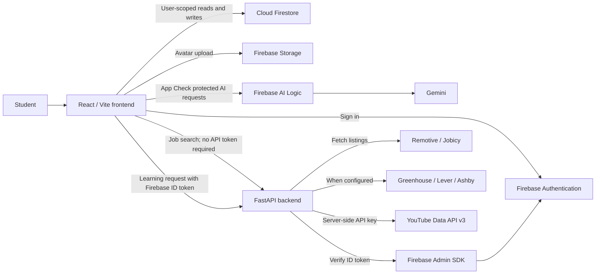
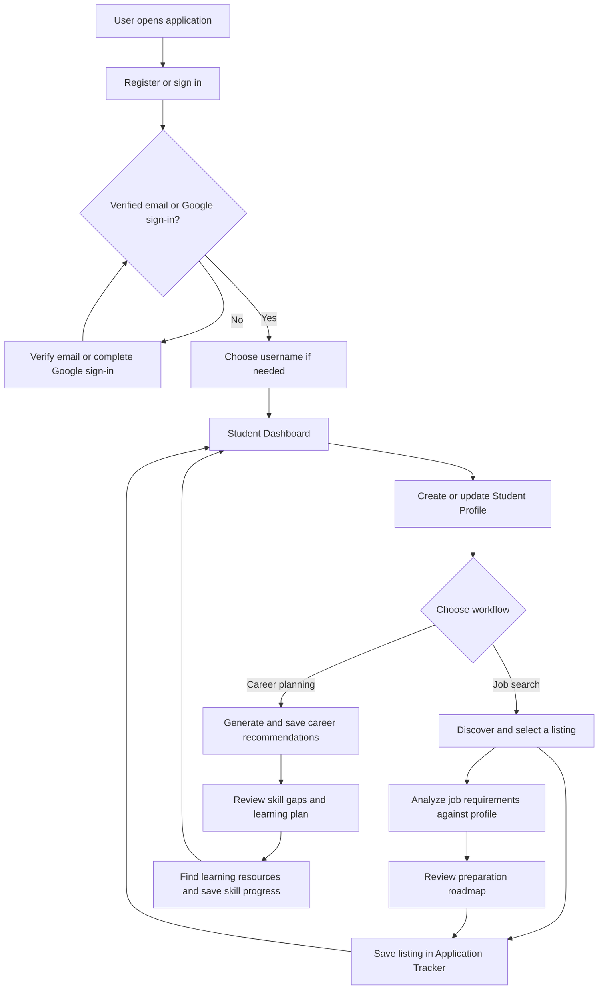
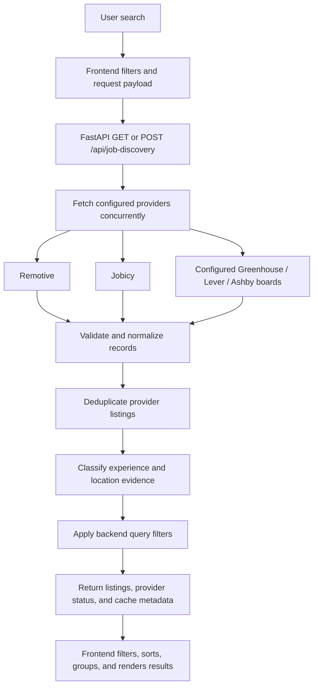
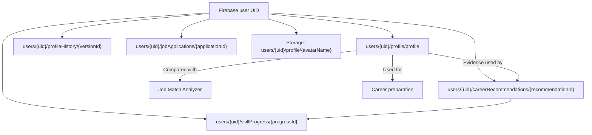

# CareerScout AI

CareerScout AI is a React and FastAPI application for student career planning, job discovery, profile-based job analysis, learning, and application tracking.

[](https://react.dev/)
[](https://fastapi.tiangolo.com/)
[](https://firebase.google.com/)
[](https://www.python.org/)

## Table of Contents

- [1. Project Overview](#1-project-overview)
- [2. Features and Modules](#2-features-and-modules)
- [3. Technology Stack](#3-technology-stack)
- [4. System Architecture](#4-system-architecture)
- [5. Overall Application Workflow](#5-overall-application-workflow)
- [6. Detailed Module Workflows](#6-detailed-module-workflows)
- [7. Job Discovery Architecture](#7-job-discovery-architecture)
- [8. Firebase and Database Architecture](#8-firebase-and-database-architecture)
- [9. Project Directory Structure](#9-project-directory-structure)
- [10. Prerequisites](#10-prerequisites)
- [11. Installation and Configuration](#11-installation-and-configuration)
- [12. Environment Variables](#12-environment-variables)
- [13. Running the Application](#13-running-the-application)
- [14. API Documentation](#14-api-documentation)
- [15. Testing and Validation](#15-testing-and-validation)
- [16. Security and Data Protection](#16-security-and-data-protection)
- [17. Known Limitations](#17-known-limitations)
- [18. Future Improvements](#18-future-improvements)
- [19. Screenshots](#19-screenshots)
- [20. Contribution Guidelines](#20-contribution-guidelines)
- [21. License and Acknowledgements](#21-license-and-acknowledgements)

## 1. Project Overview

### 1.1 Introduction

CareerScout AI combines profile-based career recommendations with external job search, job-description analysis, learning resources, and application tracking.

### 1.2 Problem Statement

Students and early-career job seekers often manage career planning, job research, skills preparation, and application status across separate tools. CareerScout AI brings these workflows together while showing where its data comes from.

### 1.3 Project Objectives

- Organize career and profile information in one application.
- Help users compare their profile evidence with career paths and job descriptions.
- Surface listings from a limited set of external job providers.
- Connect preparation areas to learning resources and application tracking.

### 1.4 Target Users

- Students exploring potential career paths.
- Early-career job seekers organizing searches and applications.
- Contributors interested in the project’s React, FastAPI, and Firebase implementation.

## 2. Features and Modules

The status below describes the current implementation, not a guarantee of accuracy or job availability.

| No. | Module | Description | Status |
| --- | --- | --- | --- |
| 2.1 | Authentication | Firebase email/password and Google sign-in with verified-user access checks. | Implemented |
| 2.2 | Student Dashboard | Summaries and navigation for profile, career, and skill activity. | Implemented |
| 2.3 | Student Profile | User-scoped education, skills, projects, preferences, and profile history. | Implemented |
| 2.4 | Career Recommendations | Career-catalogue recommendations with Gemini-assisted explanations and a rule-based fallback. | Implemented |
| 2.5 | AI Job Match Analyzer | Gemini requirement extraction and text-evidence comparison with profile data. | Partially implemented |
| 2.6 | Advanced Job Discovery | Search across integrated aggregators and optionally configured company boards. | Partially implemented |
| 2.7 | Job Application Tracker | Firestore-backed opportunity records, statuses, notes, and follow-up information. | Implemented |
| 2.8 | Skill Gap Analysis | Identifies requirements without matching profile text; these are unverified, not proven skill gaps. | Partially implemented |
| 2.9 | Learning Resources | Curated resources and YouTube search for selected skills and languages. | Partially implemented |
| 2.10 | Preparation Roadmap | Career-path preparation and listing-specific suggested tasks. | Partially implemented |
| 2.11 | Resume Builder and Settings | Editable local resume preview and account/theme settings. | Implemented |

### 2.1 Authentication

**Purpose**

- Authenticate users and restrict student-facing pages to accepted sign-in states.

**Key Features**

- Firebase email/password registration and sign-in.
- Email verification and verification-email resend.
- Google sign-in.
- Username setup after verified access.

**Working Process**

1. Register or sign in with Firebase Authentication.
2. Verify an email/password account or continue with Google sign-in.
3. Complete username setup when prompted and open protected pages.

### 2.2 Student Dashboard

**Purpose**

- Summarize saved profile and career activity and provide navigation to application modules.

**Key Features**

- Profile completeness and skill-progress indicators.
- Saved career paths, next roadmap skills, and recent profile or skill activity.
- Navigation to profile, recommendations, learning, job discovery, analyzer, tracker, and resume builder.

**Working Process**

1. Load user-scoped profile, recommendation, progress, and profile-history data from Firestore.
2. Calculate summary indicators and show module shortcuts.

### 2.3 Student Profile

**Purpose**

- Store profile evidence used by recommendations, matching, and career preparation.

**Key Features**

- Education, skills, interests, experience level, projects, certifications, work preferences, and professional links.
- Profile-history review and restore.
- Optional Firebase Storage profile photo.

**Working Process**

1. Edit profile fields and optionally select a photo.
2. Save the current profile and history under the signed-in user’s Firestore paths.
3. Other modules load this saved information when needed.

### 2.4 Career Recommendations

**Purpose**

- Suggest roles from the local career catalogue based on profile evidence.

**Key Features**

- Profile-to-role matching uses education, skills, projects, interests, and preferences.
- Gemini can provide recommendation explanations and next steps through Firebase AI Logic.
- Catalogue-based rule recommendations are used when Gemini is unavailable or a non-authorization request fails.
- Generated recommendation sets are stored in the user's Firestore collection.
- Compatibility scores are estimates, not hiring probabilities.

**Working Process**

1. Load the signed-in user’s saved profile.
2. Match profile evidence to career-catalogue roles.
3. Generate AI-assisted or rule-based recommendations and save the result.

### 2.5 AI Job Match Analyzer

**Purpose**

- Compare requirements extracted from a job description with profile evidence.

**Key Features**

- Gemini extracts explicitly stated skills and competencies through Firebase AI Logic.
- Browser-side comparison uses profile skills, projects, certifications, and optional pasted resume text.
- Results show matching and unverified requirements with a text-match percentage.
- The result is not a measure of competence, suitability, or hiring probability.

**Working Process**

1. Load the user’s profile.
2. Submit a job description for Gemini requirement extraction.
3. Compare extracted requirements with profile and optional resume evidence.
4. Review matched and unverified items and open related learning resources.

### 2.6 Advanced Job Discovery

**Purpose**

- Search and inspect listings returned by integrated job providers.

**Key Features**

- Role/category, keyword, company, location, skill, work-mode, employment, and experience filters.
- Source attribution, sorting, company grouping, profile comparison, and job-preparation roadmaps.
- External LinkedIn Jobs, Naukri, Indeed, and Google Jobs searches are links, not integrated listings.

**Working Process**

1. Select search terms and filters.
2. Send a request to the FastAPI job-discovery endpoint.
3. Review returned listings and provider status, then analyze or save a listing.

### 2.7 Job Application Tracker

**Purpose**

- Maintain a user-owned record of opportunities and application progress.

**Key Features**

- Create, edit, and delete application records.
- Statuses: Saved, Applied, Interview, Offer, Rejected, and Withdrawn.
- Search by company/title; filter by status; sort by saved or follow-up date.
- Summary counts for applications, interviews, and offers.

**Working Process**

1. Add an opportunity manually or prefill it from Job Discovery.
2. Update its status, dates, description, or notes.
3. Filter and review saved opportunities and follow-ups.

### 2.8 Skill Gap Analysis

**Purpose**

- Show which career-path or job-listing requirements have matching profile evidence.

**Key Features**

- Career recommendations compare profile evidence with catalogue pathways.
- Job analysis compares extracted requirements with profile and optional resume text.
- Listing comparison identifies requirements found in listing text or provider skill tags.
- A missing text match means “unverified”; it does not establish that the user lacks a skill.

**Working Process**

1. Select a saved career path or analyze a job listing.
2. Compare available requirements with the user’s profile evidence.
3. Review matched items and areas to verify or prepare.

### 2.9 Learning Resources

**Purpose**

- Connect career-plan skills to curated references and searchable videos.

**Key Features**

- Curated resources are selected from a local resource catalogue.
- YouTube search is proxied through FastAPI and requires an authenticated, verified account.
- Language options: English, Kannada, Hindi, Telugu, Tamil, Malayalam, Marathi, and Bengali.
- Career skill completion is saved in Firestore.

**Working Process**

1. Select a saved career path and learning languages, or open a focused skill.
2. Load curated resources and YouTube results.
3. Open a resource or update persisted skill completion.

### 2.10 Preparation Roadmap

**Purpose**

- Turn a career path or job posting into suggested preparation steps.

**Key Features**

- Career catalogue pathways provide ordered skills, priorities, exercises, and project milestones.
- Job Discovery can create listing-specific plans for 2, 4, 8, or 12 weeks.
- Listing plans include skill, portfolio, resume, and interview tasks.
- Listing-roadmap checkboxes are not persisted; career skill completion is stored separately.

**Working Process**

1. Choose a recommendation or listing.
2. Review suggested skills and milestones.
3. Open related learning resources; mark career-plan skills complete in Learning Resources.

### 2.11 Resume Builder and Settings

**Purpose**

- Provide basic resume preparation and account preferences.

**Key Features**

- Resume Builder starts with saved profile details and supports editable fields, live preview, and print/save-as-PDF.
- Resume draft edits are not saved to Firestore.
- Settings supports username and theme changes, sign-out, account details, and password changes for email/password accounts.

**Working Process**

1. Open Resume Builder or Settings from the signed-in application.
2. Edit the local resume draft or update supported account settings.

## 3. Technology Stack

| Layer | Technology | Purpose |
| --- | --- | --- |
| Frontend | React 18, JavaScript, Vite 6 | Single-page application and development/build tooling. |
| Client services | Firebase JavaScript SDK | Authentication, Firestore, Storage, App Check, and Firebase AI Logic. |
| Backend | Python 3.10+, FastAPI, Uvicorn | Job-provider aggregation and authenticated YouTube search proxy. |
| Database | Cloud Firestore | User profiles, profile history, recommendations, skill progress, and applications. |
| File storage | Firebase Storage | User profile avatar uploads. |
| Authentication | Firebase Authentication | Email/password and Google identity. |
| Generative AI | Gemini through Firebase AI Logic | Career recommendation enrichment and job requirement extraction. |
| Job data | Remotive, Jobicy; optional Greenhouse, Lever, Ashby boards | External listings normalized by the backend. |
| Learning search | YouTube Data API v3 | Backend-proxied video search. |
| Backend tests | Python `unittest` | Authentication and job-discovery API/provider tests. |
| Frontend tests | Node.js built-in test runner | Utility and classification tests. |

## 4. System Architecture

The React client communicates directly with Firebase for user authentication and user-scoped Firestore and Storage operations. Firebase AI Logic requests also originate in the client.

FastAPI aggregates job-provider responses and proxies YouTube search. Firebase Admin is used by the learning-resource route to verify Firebase ID tokens; the backend does not read or write user Firestore documents.



Job Discovery pages are gated by frontend authentication, but their API routes do not require authentication. The Learning Resources API route verifies the Firebase token and account verification state.

## 5. Overall Application Workflow

Career planning and job search are separate paths that can share profile evidence and lead to learning or application tracking.



## 6. Detailed Module Workflows

### 6.1 Firebase Authentication

1. The frontend initializes Firebase Authentication from `VITE_FIREBASE_*` configuration.
2. Users register/sign in with email/password or Google.
3. Email/password accounts must verify their email before protected pages are available; Google sign-in is accepted as verified access.
4. The frontend listens for the Firebase user state and gates protected application views.
5. The Learning Resources backend route independently verifies the ID token with Firebase Admin.

### 6.2 Student Profile Management

1. The client reads and writes `users/{uid}/profile/profile`.
2. Profile edits are versioned under `users/{uid}/profileHistory/{versionId}`.
3. Optional images are processed as JPEG and uploaded to `users/{uid}/profile/{avatarName}`.
4. Profile, recommendation, and analysis modules read the saved data as needed.

### 6.3 AI Career Recommendations

1. The client loads the saved profile and matches it to local career-catalogue paths.
2. Firebase AI Logic can request Gemini recommendation explanations and next steps.
3. Validated recommendations are stored under `users/{uid}/careerRecommendations/{recommendationId}`.
4. Rule-based catalogue recommendations are used in supported AI failure cases; authorization failures are not silently treated as success.

The career recommendation flow uses Gemini `gemini-3.8-flash` through Firebase AI Logic.

### 6.4 Job Matching

1. The user submits a job description from the Job Match Analyzer.
2. Firebase AI Logic asks Gemini to extract explicitly stated requirements.
3. The frontend compares extracted requirements with saved skills, projects, certifications, and optional pasted resume text.
4. The interface presents matching and unverified text evidence.

The pasted resume text is compared in the browser by this analyzer; it is not saved or sent by that comparison step. Job descriptions are sent to Gemini for extraction. Matching percentages are not verified skill or hiring scores.

### 6.5 Skill Gap Analysis

1. The user selects a saved career path or job listing.
2. The application compares known requirements against profile text and, where applicable, job-description text.
3. Items without a matching text signal are presented as missing or unverified preparation areas, not proof of inability.
4. Career-path skill completion can be stored in `users/{uid}/skillProgress/{progressId}`.

### 6.6 Job Application Tracking

1. A listing can prefill a tracker record, or the user can enter one manually.
2. The client creates or updates the record at `users/{uid}/jobApplications/{applicationId}`.
3. The tracker filters by status and searches by company or title.
4. Firestore rules validate the record fields and supported status values.

### 6.7 Learning Resources

1. Curated learning items are loaded from the frontend resource catalogue.
2. For video search, the frontend requests an ID token and calls the backend Learning Resources endpoint.
3. The backend verifies the token and queries YouTube Data API v3 using the configured backend key.
4. The client displays returned video details and can save career-skill progress to Firestore.

## 7. Job Discovery Architecture

### 7.1 Supported Job Providers

| Provider | Integration | Availability and limits |
| --- | --- | --- |
| Remotive | Remote-jobs feed | Queried by default; up to 100 normalized records; 8-hour process-local cache. |
| Jobicy | Public remote-jobs API | Queried by default; up to two pages of 200 per keyword; 1-hour cache per keyword. |
| Greenhouse | Company board API | Queried only for a configured board identifier. |
| Lever | Company board API | Queried only for a configured board identifier. |
| Ashby | Company board API | Queried only for a configured board identifier. |

Greenhouse, Lever, and Ashby are optional company-board integrations. They are not globally searched unless board identifiers have been configured by the operator.

### 7.2 Job Search Process



### 7.3 Search and Filtering

| Search/filter | Behavior |
| --- | --- |
| Keyword and role | Searches free text and selected role terms/synonyms. |
| Category | Uses frontend career/job category terms in the provider query and client filtering. |
| Skills | Selectable skill terms are matched against available listing text, category, or provider skill tags. Multiple selected skills use an any-match approach. |
| Company | Filters by company; company mode can select an operator-configured company board. |
| Location | Filters or groups using provider location data and remote-location signals. |
| Work mode | Supports Remote, Hybrid, and On-site filters. Unknown metadata remains unconfirmed rather than treated as a known mismatch. |
| Employment | Supports Full-time, Part-time, Internship, and Contract filters; missing metadata remains visible as unknown. |
| Experience | Supports fresher/graduate, entry-level, and experienced selections. |
| Sort and group | The frontend can sort by provider order, newest, company, or title, and group listings by company. |

Role synonyms and category terms originate in the frontend taxonomy. The backend limits requests to 500 results, 12 role terms, and 30 skill terms; individual role and skill strings are bounded.

### 7.4 Experience Classification

Opportunity type and seniority are classified separately. A job may be an internship with unknown seniority, or a full-time position at another seniority level.

| Classification source | Meaning |
| --- | --- |
| Source-reported | Provider metadata clearly identifies the classification. |
| Title-inferred | Clear title wording indicates an internship or seniority. |
| Description-inferred | Explicit description wording indicates eligibility or seniority. |
| Unknown | Evidence is absent, ambiguous, or conflicting. |

- Internship can be classified from clear provider fields, an internship title, or explicit internship wording.
- Fresher/graduate, entry-level, and experienced labels use provider values or conservative title/description signals.
- “Full-time” alone does not establish seniority.
- Unknown results remain accessible in the unconfirmed group and are excluded from confirmed-match counts.

### 7.5 Internship and Fresher Search

- The interface provides experience/opportunity filters and classification groups.
- Listings are labeled from provider fields or explicit title/description evidence where available.
- The integrations do not guarantee dedicated fresher or internship coverage.
- Unknown listings are not classified as eligible or ineligible.

### 7.6 Work Mode and Employment Filters

- Work-mode filtering uses provider location/work-mode evidence; remote-global and remote-unspecified results are distinguished from a location-specific match.
- Employment filtering recognizes the available full-time, part-time, internship, and contract values.
- Missing or ambiguous values remain visible as unknown where the client filter permits; they are not silently asserted to match.
- Provider feeds are remote-focused, so onsite and hybrid coverage is limited.

### 7.7 Provider Caching

| Provider group | Cache lifetime | Cache scope |
| --- | --- | --- |
| Remotive | 8 hours | One process-local normalized feed. |
| Jobicy | 1 hour | Process-local cache per keyword. |
| Greenhouse, Lever, Ashby | 15 minutes | Process-local cache for configured company-board requests. |

Caches are held in backend process memory. They are not shared across instances and are cleared on backend restart.

### 7.8 Company Board Integration

- Company board identifiers are supplied through the backend-only `COMPANY_JOB_BOARDS_JSON` variable.
- Supported board types are `greenhouse`, `lever`, and `ashby`.
- Company search only uses configured boards; no boards are configured by default.
- A maximum of 12 configured company board profiles are searched per request.
- Company profiles can include official name, website, careers URL, description, industry, headquarters, office locations, and verification date.
- Careers-page links without a configured provider board are external links, not integrated listings.

Example configuration shape (use verified board identifiers; this is not a preconfigured list):

```json
{
  "Example Company": {
    "officialName": "Example Company",
    "website": "https://example.com",
    "careersUrl": "https://example.com/careers",
    "boards": {
      "greenhouse": "verified-board-token",
      "lever": "verified-board-token",
      "ashby": "verified-board-token"
    }
  }
}
```

Only include the board providers actually used for a company. The backend validates board identifiers and accepts HTTPS URLs for company links.

### 7.9 Result Attribution and Limitations

- Integrated results include provider/source attribution and a source link where supplied.
- The API distinguishes aggregator listings from official company-board listings.
- LinkedIn Jobs, Naukri, Indeed, and Google Jobs open external searches; their pages are not scraped into CareerScout listings.
- Provider results may be incomplete, stale, unavailable, or missing experience, employment, work-mode, location, or salary data.
- Source attribution does not guarantee that a listing is active or employer-verified.

## 8. Firebase and Database Architecture

### 8.1 Authentication

- Firebase Authentication supports email/password and Google sign-in.
- The frontend requires a verified email or Google sign-in for protected application access.
- The Learning Resources API verifies Firebase ID tokens through Firebase Admin.
- Job Discovery API routes are not authenticated at the API layer.

### 8.2 Firestore Collections and Documents

All paths below are scoped to a Firebase user UID. The checked-in `firestore.rules` restricts the data to the verified owner.

| Firestore path | Data | Rule access |
| --- | --- | --- |
| `users/{uid}/profile/profile` | Student profile and selected career information. | Owner read/write when email is verified or sign-in provider is Google. |
| `users/{uid}/profileHistory/{versionId}` | Profile history versions. | Owner read/write under the same verification condition. |
| `users/{uid}/careerRecommendations/{recommendationId}` | Generated recommendation sets and timestamps. | Owner read/create. |
| `users/{uid}/skillProgress/{progressId}` | Career skill completion and timestamps. | Owner read/write. |
| `users/{uid}/jobApplications/{applicationId}` | Job and application details. | Owner read/create/update/delete; writes are field-validated. |

The job-application rule validates allowed fields, supported statuses and employment types, string limits, URL/date formats, and saved-timestamp behavior. There are no backend Firestore document reads or writes in the current API implementation.

### 8.3 Firebase Storage

| Storage path | Use | Rule access |
| --- | --- | --- |
| `users/{uid}/profile/{avatarName}` | JPEG profile avatar. | Verified owner read/write/delete; filename must match the avatar pattern; upload limit is 2 MB. |

The frontend processes supported JPEG, PNG, or WebP selections before uploading a JPEG avatar.

### 8.4 Data Relationships



### 8.5 Security Rules

- `firebase.json` points Firebase CLI to the checked-in `firestore.rules` and `storage.rules`.
- Firestore rules enforce owner UID and verified-email/Google-provider access for the documented collections.
- Application records are schema-validated by Firestore rules.
- Storage rules constrain avatar access, filename, content type, and size.
- Rules must be deployed to the Firebase project used by the application; local files alone do not enforce remote access.

## 9. Project Directory Structure

```text
CareerScout-AI/
├── backend/
│   ├── main.py
│   ├── requirements.txt
│   ├── test_auth.py
│   └── test_job_discovery.py
├── frontend/
│   ├── .env.example
│   ├── index.html
│   ├── package-lock.json
│   ├── package.json
│   ├── src/
│       ├── App.jsx
│       ├── AuthPanel.jsx
│       ├── CareerExplorer.jsx
│       ├── CareerRecommendations.jsx
│       ├── JobApplicationTracker.jsx
│       ├── JobDiscovery.jsx
│       ├── JobMatchAnalyzer.jsx
│       ├── ResumeBuilder.jsx
│       ├── SettingsPage.jsx
│       ├── SkillGapLearning.jsx
│       ├── StudentDashboard.jsx
│       ├── StudentProfile.jsx
│       ├── UsernameSetup.jsx
│       ├── ai.js
│       ├── careerCatalog.js
│       ├── firebase.js
│       ├── jobApplicationUtils.js
│       ├── jobDiscoveryUtils.js
│       ├── jobDiscoveryUtils.test.js
│       ├── jobMatchAi.js
│       ├── jobMatchUtils.js
│       ├── learningResourcesApi.js
│       ├── main.jsx
│       ├── resourceCatalog.js
│       ├── resumeEducation.js
│       ├── settingsUtils.js
│       ├── studentProfileUtils.js
│       ├── studentProfileUtils.test.js
│       └── style.css
│   └── tests/
│       ├── careerCatalog.test.js
│       ├── jobApplicationUtils.test.js
│       ├── jobMatchAi.test.js
│       ├── jobMatchUtils.test.js
│       ├── learningResourcesApi.test.js
│       ├── resumeEducation.test.js
│       └── settingsUtils.test.js
├── shared/
│   └── experienceClassificationCases.json
├── .gitignore
├── firebase.json
├── firestore.rules
├── README.md
└── storage.rules
```

| File or directory | Responsibility |
| --- | --- |
| `frontend/src/` | React views, Firebase client setup, career/job utilities, and frontend tests. |
| `frontend/tests/` | Frontend tests for career catalogue, tracker utilities, job matching, learning requests, resume education, and settings. |
| `frontend/src/App.jsx` | Authentication gating and application navigation. |
| `frontend/src/ai.js`, `jobMatchAi.js` | Firebase AI Logic and Gemini workflows. |
| `frontend/src/careerCatalog.js`, `jobDiscoveryUtils.js` | Career data, role matching, job filtering, and classification. |
| `backend/main.py` | FastAPI endpoints, Firebase token verification, provider adapters, and YouTube proxy. |
| `backend/test_*.py` | Backend authentication, job-provider, and API tests. |
| `firestore.rules`, `storage.rules` | Firebase database and file-access rules. |
| `shared/experienceClassificationCases.json` | Shared experience-classification test cases. |

## 10. Prerequisites

| Requirement | Version / details |
| --- | --- |
| Git | Required to clone and contribute. |
| Python | 3.10 or later for the backend. |
| Node.js and npm | Node.js 18 or later; npm is included with Node.js. |
| Firebase project | Authentication, Firestore, Storage, Firebase AI Logic, and App Check configuration for the corresponding features. |
| Google Application Default Credentials | Required for backend Firebase Admin token verification; local development can use `gcloud auth application-default login`. |
| YouTube Data API key | Optional for backend startup; required for YouTube video search. |
| Firebase CLI | Optional; required to deploy the checked-in Firestore and Storage rules. |

## 11. Installation and Configuration

### 11.1 Clone Repository

```powershell
git clone https://github.com/bhanurgowda12/CareerScout-AI.git
Set-Location .\CareerScout-AI
```

### 11.2 Firebase Project Setup

1. Create or select a Firebase project and register a Web app.
2. Enable Email/Password and Google providers in Firebase Authentication.
3. Enable Cloud Firestore and Firebase Storage.
4. Configure Firestore and Storage rules for the project. The repository’s `firebase.json` references `firestore.rules` and `storage.rules`.
5. Install Firebase CLI if needed, select the project, and deploy rules:

   ```powershell
   firebase login
   firebase use --add
   firebase deploy --only firestore:rules,storage
   ```

6. Copy the Firebase Web app configuration into `frontend\.env.local` as described in [Section 12](#12-environment-variables).

### 11.3 Gemini Configuration

1. Enable Firebase AI Logic for the Firebase project and configure Gemini access in the Firebase console.
2. The frontend uses Firebase AI Logic with the Google AI backend; it does not call Gemini through the FastAPI service.
3. Career recommendations use `gemini-3.8-flash`.
4. Job requirement extraction uses `gemini-3.5-flash-lite`, with `gemini-3.8-flash` as a fallback.
5. Configure Firebase App Check as described below for AI requests.

### 11.4 App Check Configuration

1. Register the web app with Firebase App Check using the reCAPTCHA Enterprise provider.
2. Set `VITE_FIREBASE_APP_CHECK_SITE_KEY` to the corresponding site key.
3. For local debugging only, set `VITE_FIREBASE_APP_CHECK_DEBUG=true` and register the generated debug token in Firebase App Check.
4. Keep debug mode disabled for production builds.

### 11.5 Backend Environment Setup

From the repository root, create a Python virtual environment and install backend dependencies:

```powershell
Set-Location .\backend
py -m venv .venv
.\.venv\Scripts\Activate.ps1
python -m pip install -r requirements.txt
```

Create `backend\.env` (ignored by Git) or set environment variables in the backend process:

```dotenv
FIREBASE_PROJECT_ID=your-firebase-project-id
YOUTUBE_API_KEY=your-restricted-youtube-data-api-key
```

Optional variables such as `COMPANY_JOB_BOARDS_JSON` and `CAREERSCOUT_ALLOWED_ORIGINS` are listed in [Section 12](#12-environment-variables). The backend loads `backend/.env` with `python-dotenv`.

For local Firebase Admin credentials, configure Application Default Credentials:

```powershell
gcloud auth application-default login
```

Alternatively, set `GOOGLE_APPLICATION_CREDENTIALS` to a service-account JSON file stored outside the repository. Do not commit the file.

### 11.6 Frontend Environment Setup

From the repository root:

```powershell
Set-Location .\frontend
npm ci
if (-not (Test-Path .env.local)) { Copy-Item .env.example .env.local }
```

Edit `frontend\.env.local` with the Firebase Web app values and App Check site key. Restart Vite after changing environment values.

## 12. Environment Variables

### 12.1 Frontend Variables

| Variable | Purpose | Required / Optional |
| --- | --- | --- |
| `VITE_FIREBASE_API_KEY` | Firebase Web app configuration. | Required for Firebase frontend |
| `VITE_FIREBASE_AUTH_DOMAIN` | Firebase Web app configuration. | Required for Firebase frontend |
| `VITE_FIREBASE_PROJECT_ID` | Firebase Web app configuration. | Required for Firebase frontend |
| `VITE_FIREBASE_STORAGE_BUCKET` | Firebase Storage bucket. | Required for profile photo uploads |
| `VITE_FIREBASE_MESSAGING_SENDER_ID` | Firebase Web app configuration. | Required for Firebase frontend |
| `VITE_FIREBASE_APP_ID` | Firebase Web app configuration. | Required for Firebase frontend |
| `VITE_FIREBASE_APP_CHECK_SITE_KEY` | reCAPTCHA Enterprise site key for Firebase App Check. | Required for App Check-backed AI usage |
| `VITE_FIREBASE_APP_CHECK_DEBUG` | Enables App Check debug mode in development only. | Optional; defaults to `false` |
| `VITE_API_BASE_URL` | FastAPI base URL. | Optional; defaults to `http://127.0.0.1:8000` |

These values are defined in the tracked `frontend/.env.example`. `VITE_` variables are included in the browser bundle and must not contain private credentials.

### 12.2 Backend Variables

| Variable | Purpose | Required / Optional |
| --- | --- | --- |
| `FIREBASE_PROJECT_ID` | Firebase Admin token-verification project. | Required for protected Learning Resources API |
| `YOUTUBE_API_KEY` | YouTube Data API v3 access. | Optional for API startup; required for video search |
| `GOOGLE_APPLICATION_CREDENTIALS` | Google Auth path to a service-account JSON file for ADC. | Optional when other ADC is configured |
| `COMPANY_JOB_BOARDS_JSON` | Company profiles and board identifiers for Greenhouse, Lever, or Ashby. | Optional; no boards are configured by default |
| `CAREERSCOUT_ALLOWED_ORIGINS` | Comma-separated additional CORS origins. | Optional; local Vite origins are built in |

The backend loads `backend/.env`; no backend environment example file is tracked. Never commit populated environment files, private keys, service-account files, or App Check debug tokens.

## 13. Running the Application

### 13.1 Start the Backend

In a PowerShell terminal, from the repository root:

```powershell
Set-Location .\backend
.\.venv\Scripts\Activate.ps1
python -m uvicorn main:app --reload --host 127.0.0.1 --port 8000
```

The backend listens at `http://127.0.0.1:8000`. Health check: `http://127.0.0.1:8000/api/health`.

### 13.2 Start the Frontend

In a second PowerShell terminal, from the repository root:

```powershell
Set-Location .\frontend
npm run dev
```

Open the URL printed by Vite (normally `http://localhost:5173`). Create a production build with:

```powershell
npm run build
```

## 14. API Documentation

Local base URL: `http://127.0.0.1:8000`. FastAPI interactive documentation is available at `/docs`.

| Method | Endpoint | Purpose | Request | Authentication |
| --- | --- | --- | --- | --- |
| `GET` | `/` | API welcome response. | None. | None. |
| `GET` | `/api/health` | API health status. | None. | None. |
| `GET` | `/api/job-discovery` | Search provider listings. | Query parameters described below. | None at API layer. |
| `POST` | `/api/job-discovery` | Search provider listings using JSON filters. | `JobDiscoverySearchRequest` JSON body. | None at API layer. |
| `GET` | `/api/learning-resources` | Search YouTube videos for a skill. | `skill`, `language`, optional `pageToken`. | Firebase ID token; verified email or Google provider. |

### 14.1 Job Discovery Request

The `GET` endpoint accepts the same fields as query parameters; list fields can be repeated. The `POST` endpoint accepts a JSON object with these fields:

| Field | Type | Constraints / purpose |
| --- | --- | --- |
| `query` | String or null | Free-text search; maximum 100 characters. |
| `category` | String array | Category search terms. |
| `roleTerms` | String array | Role names/synonyms; up to 12 terms. |
| `skills` | String array | Skill terms; up to 30. |
| `company` | String or null | Optional company filter. |
| `location` | String or null | Optional location filter. |
| `workMode` | String or null | Optional work-mode filter. |
| `employmentType` | String or null | Optional employment-type filter. |
| `experience` | String or null | Optional experience/opportunity filter. |
| `mode` | `jobs` or `company` | General job search or company search. |
| `remoteOnly` | Boolean | Restricts records known not to be remote. |
| `limit` | Integer | Number of returned records; 1–500. |

The response contains `jobs`, `fetchedAt`, `cached`, source names, provider status/errors, partial-result metadata, `totalRetrieved`, company metadata, and official-versus-aggregator listing counts. Provider failures may produce partial status or an HTTP error.

### 14.2 Learning Resources Request and Response

`GET /api/learning-resources?skill=Python&language=en` requires an `Authorization: Bearer <Firebase-ID-token>` header. Supported language codes are `en`, `kn`, `hi`, `te`, `ta`, `ml`, `mr`, and `bn`.

The response contains up to 10 `videos` and an optional `nextPageToken`. `YOUTUBE_API_KEY` must be configured on the backend. Invalid language codes return HTTP 422; missing API configuration returns HTTP 503.

## 15. Testing and Validation

Run frontend tests and build from `frontend`:

```powershell
Set-Location .\frontend
npm test
npm run build
```

Run backend tests from `backend`:

```powershell
Set-Location .\backend
python -m unittest discover -v
```

Backend provider tests mock external services; they do not verify live provider availability. Check working-tree whitespace from the repository root:

```powershell
git diff --check
```

## 16. Security and Data Protection

- Frontend protected pages require a verified email or Google sign-in.
- Firestore and Storage client access is governed by the checked-in rules and scoped to the verified owner.
- The backend Learning Resources endpoint verifies Firebase ID tokens with Firebase Admin and requires verified email or Google sign-in.
- Job Discovery API endpoints are unauthenticated at the API layer. The UI gates access, but deployments should treat these routes as public.
- YouTube API credentials and Firebase Admin credentials belong in the backend environment, not the frontend build.
- Firebase Web app configuration and the App Check site key are public client values; `VITE_` values are shipped to the browser.
- Career recommendation profile fields are sent to Firebase AI Logic; the generation code excludes profile name and email from model context.
- Job descriptions are sent to Gemini for requirement extraction. Pasted resume text in the Job Match Analyzer is compared in the browser and is not saved or sent by that analyzer.
- Deploy and review `firestore.rules` and `storage.rules` for the Firebase project in use. Repository rules do not prove that a deployed Firebase project uses them.

## 17. Known Limitations

- Remotive and Jobicy are remote-focused feeds and do not represent all local, onsite, hybrid, internship, or fresher roles.
- Jobicy retrieval is capped at two pages of 200 listings per keyword/cache key; Remotive normalization is capped at 100 listings.
- Company board searches require operator-configured Greenhouse, Lever, or Ashby board identifiers.
- Provider experience, location, employment, work-mode, and salary metadata may be missing, ambiguous, or out of date.
- Internship and seniority classification uses provider data and conservative title/description inference; unknown results are not confirmed eligible or ineligible.
- Gemini output can be unavailable or incorrect. Career fit scores are estimates; job-match percentages reflect text matches, not competence or hiring probability.
- YouTube availability, quota, and language relevance depend on the external API and provider.
- Resume Builder edits and per-listing roadmap checkboxes are not persisted. Career skill progress and tracker records are saved in Firestore.

## 18. Future Improvements

These are potential improvements, not currently implemented features or delivery commitments:

- Expand verified job sources and local, onsite, and hybrid listing coverage.
- Improve dedicated fresher and internship listing coverage.
- Improve experience classification and validation against new provider metadata.
- Expand company search into a richer Company Explorer.
- Improve skill equivalence and explainability in job matching.
- Broaden and maintain learning recommendations.
- Consider persisting custom job-roadmap progress and resume drafts.

## 19. Screenshots

Screenshots are not currently included in the repository. Add reviewed captures here when available; no image paths are assumed.

| Screen | Screenshot |
| --- | --- |
| Dashboard | *Screenshot not added* |
| Profile | *Screenshot not added* |
| Job Discovery | *Screenshot not added* |
| AI Match Analyzer | *Screenshot not added* |
| Application Tracker | *Screenshot not added* |
| Skill Gap Analysis | *Screenshot not added* |

## 20. Contribution Guidelines

1. Fork the repository.
2. Clone your fork:

   ```powershell
   git clone https://github.com/<your-account>/CareerScout-AI.git
   Set-Location .\CareerScout-AI
   ```

3. Create a feature branch:

   ```powershell
   git switch -c feature/short-description
   ```

4. Make a focused change and add or update relevant tests/documentation.
5. Run frontend tests/build and backend tests as applicable.
6. Review changes and check for secrets:

   ```powershell
   git diff --check
   git status --short
   ```

7. Commit and push your branch:

   ```powershell
   git add -A
   git commit -m "Describe the change"
   git push -u origin feature/short-description
   ```

8. Open a pull request with a concise summary and validation results.

Do not include real user data, API keys, service-account files, or App Check debug tokens.

## 21. License and Acknowledgements

No `LICENSE` file is present in the repository. The project license has not been specified; add a license before relying on reuse or redistribution permissions.

The project integrates Firebase, Gemini through Firebase AI Logic, Remotive, Jobicy, optional Greenhouse/Lever/Ashby job boards, and YouTube Data API v3. Their services and content remain subject to their own terms and availability.
