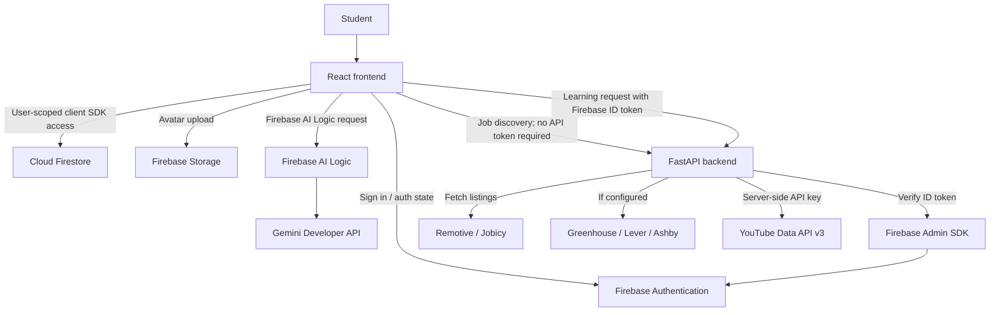
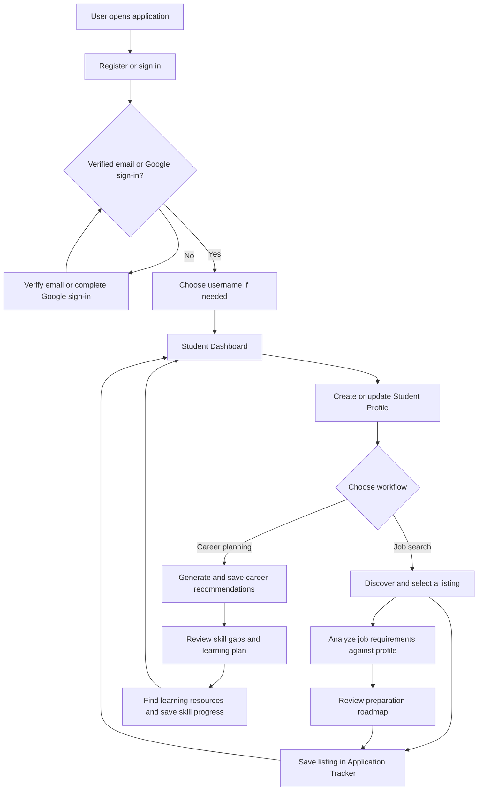
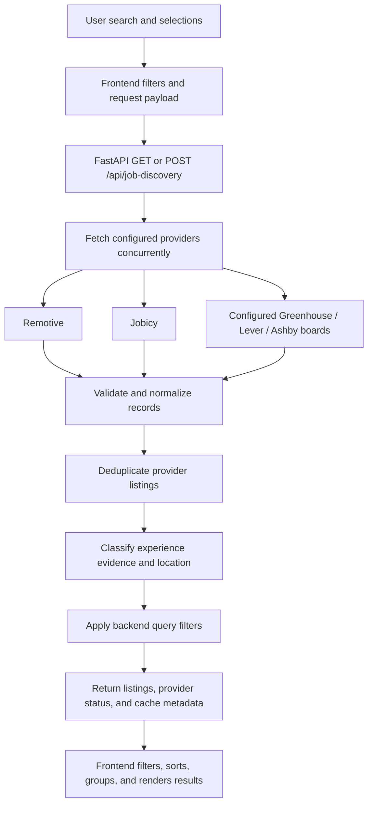
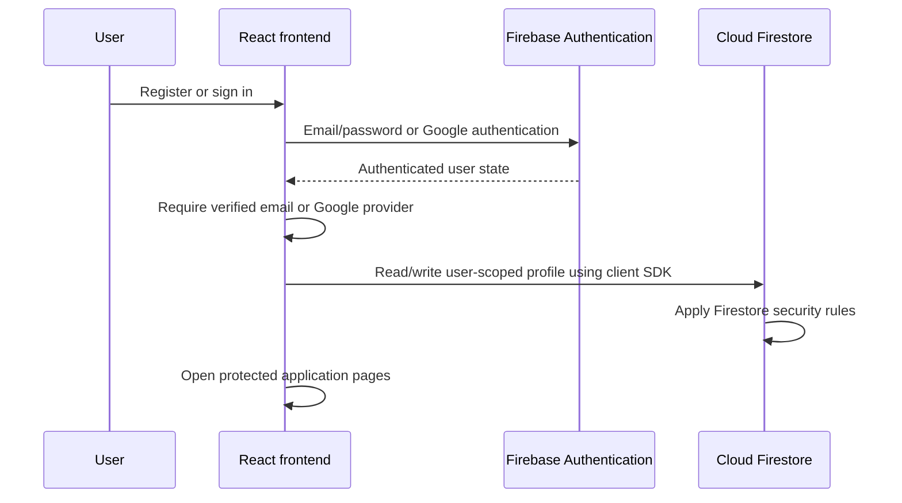

# CareerScout AI

Student career planning and job-search application built with React, FastAPI, and Firebase.

[](https://react.dev/)
[](https://vite.dev/)

[](https://fastapi.tiangolo.com/)
[](https://www.python.org/)

Repository: [bhanurgowda12/CareerScout-AI](https://github.com/bhanurgowda12/CareerScout-AI)

## Table of Contents

- [1. Project Overview](#1-project-overview)
- [2. Features and Functional Modules](#2-features-and-functional-modules)
- [3. Technology Stack](#3-technology-stack)
- [4. System Architecture](#4-system-architecture)
- [5. Application Workflow](#5-application-workflow)
- [6. Module Documentation](#6-module-documentation)
- [7. Job Discovery Architecture](#7-job-discovery-architecture)
- [8. Database and Authentication Design](#8-database-and-authentication-design)
- [9. Project Directory Structure](#9-project-directory-structure)
- [10. Backend Setup](#10-backend-setup)
- [11. Frontend Setup](#11-frontend-setup)
- [12. Environment Variables](#12-environment-variables)
- [13. API Documentation](#13-api-documentation)
- [14. Testing and Validation](#14-testing-and-validation)
- [15. Security and Data Handling](#15-security-and-data-handling)
- [16. Known Limitations](#16-known-limitations)
- [17. Future Enhancements](#17-future-enhancements)
- [18. Screenshots](#18-screenshots)
- [19. Contribution Guidelines](#19-contribution-guidelines)
- [20. License and Acknowledgements](#20-license-and-acknowledgements)

## 1. Project Overview

CareerScout AI is a web application for students and early-career job seekers. It combines profile-based career guidance, external job search, skill preparation, and application tracking.

The application helps users organize career information and compare available job-posting evidence with their own profile. Recommendations and scores are informational; they do not predict hiring decisions.

## 2. Features and Functional Modules

| Module | Description | Technology | Status |
| --- | --- | --- | --- |
| Authentication | Email/password, email verification, and Google sign-in | Firebase Authentication | Implemented |
| Student Dashboard | Profile, saved paths, learning progress, recent activity, and navigation | React, Firestore | Implemented |
| Student Profile | Education, skills, interests, projects, certifications, links, history, and avatar | React, Firestore, Firebase Storage | Implemented |
| Career Recommendations | Profile-based role suggestions, skill plans, and saved results | Career catalogue, Firebase AI Logic, Gemini, Firestore | Implemented |
| AI Job Match Analyzer | Extracts job requirements and compares them with profile/resume evidence | Firebase AI Logic, Gemini, browser-side comparison | Implemented |
| Job Discovery | Searches provider feeds and supports role, skill, location, work-mode, employment, and experience filters | React, FastAPI, external job APIs | Partially implemented: provider coverage is limited |
| Job Application Tracker | Saves, edits, filters, sorts, and tracks applications and follow-ups | React, Firestore | Implemented |
| Skill Gap Analysis | Compares career-path skills and job requirements with saved profile evidence | React, career catalogue, Gemini extraction for job descriptions | Implemented |
| Preparation Roadmap | Suggests career learning steps and per-listing 2-, 4-, 8-, or 12-week preparation tasks | React, career catalogue | Implemented |
| Learning Resources | Curated resource catalogue, YouTube video search, and persisted skill completion | React, FastAPI, YouTube API, Firestore | Partially implemented: availability depends on configuration and external data |
| Resume Builder | Creates a profile-prefilled editable draft and printable preview | React, browser print | Implemented; draft is not persisted |
| Settings | Username, theme, account details, sign-out, and email/password update | React, Firebase Authentication, Firestore | Implemented |

“Partially implemented” describes bounded provider coverage or external-service dependency, not a placeholder UI. Proposed additions are listed separately in [Section 17](#17-future-enhancements).

## 3. Technology Stack

| Layer | Technology | Purpose |
| --- | --- | --- |
| Frontend | React 18, JavaScript ES modules | UI components, page workflows, and browser-side comparisons |
| Frontend tooling | Vite 6, Node.js, npm | Development server, tests, and production build |
| Backend | Python 3.10+, FastAPI, Uvicorn | HTTP API, validation, provider retrieval, and local API server |
| Authentication | Firebase Authentication | Email/password and Google sign-in |
| Database | Cloud Firestore | User profiles, profile history, recommendations, skill progress, applications |
| File storage | Firebase Storage | Profile avatar uploads |
| AI | Firebase AI Logic, Gemini Developer API | Career recommendation text and job requirement extraction |
| Server-side identity | Firebase Admin SDK, Google Application Default Credentials | Verification of Firebase ID tokens on the learning-resource endpoint |
| Job data | Remotive, Jobicy; optional Greenhouse, Lever, Ashby boards | External job listing sources |
| Learning data | YouTube Data API v3 | Skill-related video search |
| Backend dependencies | `backend/requirements.txt` | FastAPI, Uvicorn, Firebase Admin, and python-dotenv |
| Frontend dependencies | `frontend/package.json` | React, Firebase SDK, Vite, and React plugin |

## 4. System Architecture

The frontend connects directly to Firebase client services. FastAPI does not read or write profile documents. It serves job-discovery requests and proxies YouTube search; Firebase Admin verifies ID tokens on the learning-resource route.



Job Discovery is protected by the frontend's verified-user navigation, but its API routes do not require authentication. The learning-resource API route verifies the Firebase token and account verification state.

## 5. Application Workflow

The user can choose separate career-planning and job-search paths from the dashboard.



## 6. Module Documentation

### 6.1 Authentication

**Purpose**

- Authenticate users and gate student-facing pages.

**Key functionality**

- Firebase email/password registration and sign-in.
- Email verification and verification-email resend.
- Google sign-in.
- Username setup after verified access.

**Workflow**

1. Register or sign in.
2. Verify email for email/password accounts; Google sign-in is accepted as verified access.
3. Choose a username, then open protected pages.

### 6.2 Student Dashboard

**Purpose**

- Summarize the user's saved career and learning activity and provide module navigation.

**Key functionality**

- Profile completeness and skill-progress indicators.
- Saved career paths, next roadmap skills, and recent profile/skill activity.
- Navigation to profile, recommendations, learning, job discovery, analyzer, tracker, and resume builder.

**Workflow**

1. Load user-scoped profile, recommendation, progress, and recent profile-history data from Firestore.
2. Calculate summary indicators and display shortcuts.

### 6.3 Student Profile

**Purpose**

- Store profile evidence used by recommendations, matching, and career preparation.

**Key functionality**

- Education, skills, interests, experience level, projects, certifications, preferred work areas/industries, and professional links.
- Firestore profile save, profile-history review and restore.
- Optional Firebase Storage profile photo.

**Workflow**

1. Edit profile fields and optionally select a photo.
2. Save the profile to the signed-in user's profile document.
3. Other modules load that saved evidence when needed.

### 6.4 AI Job Match Analyzer

**Purpose**

- Compare requirements extracted from a job description with profile evidence.

**Key functionality**

- Gemini extracts explicitly stated skills and competencies through Firebase AI Logic.
- Browser compares requirements with saved skills, projects, certifications, and optional pasted resume text.
- Results show matched and unverified requirements and a percentage of identified requirements with matching text evidence.

**Workflow**

1. Load the signed-in user's profile.
2. Submit a job description for Gemini requirement extraction.
3. Compare extracted requirements with profile and optional resume evidence.
4. Review the results and continue to relevant learning resources.

### 6.5 Job Discovery

**Purpose**

- Find and inspect listings returned by integrated job providers.

**Key functionality**

- Role/category, keyword, company, location, skill, work-mode, employment, and experience filters.
- Source attribution, sorting, company grouping, profile comparison, and job-preparation roadmaps.
- External job-board search links are labeled separately from integrated listings.

**Workflow**

1. Select search terms and filters.
2. Frontend sends a request to FastAPI.
3. Review returned listings and provider status, then analyze or save a listing.

### 6.6 Job Application Tracker

**Purpose**

- Maintain a user-owned record of saved opportunities and application progress.

**Key functionality**

- Create, edit, and delete application records.
- Status values: Saved, Applied, Interview, Offer, Rejected, Withdrawn.
- Search by company/title; filter by status; sort by saved or follow-up date.
- Summary counts for applications, interviews, and offers.

**Workflow**

1. Add an application manually or prefill it from Job Discovery.
2. Update status, dates, description, or notes as the process changes.
3. Filter and review follow-ups in the tracker.

### 6.7 Skill Gap Analysis

**Purpose**

- Show which role or listing requirements have matching evidence in the user's profile.

**Key functionality**

- Career recommendations compare profile evidence with catalogue pathways.
- Job analysis compares extracted requirements with profile and optional resume text.
- Listing comparison identifies requirements found in listing text or provider skill tags.
- A missing text match means “unverified,” not that the user lacks the skill.

**Workflow**

1. Select a saved career path or analyze a job listing.
2. Compare the available requirements with profile evidence.
3. Review matched items and areas to verify or prepare.

### 6.8 Preparation Roadmap

**Purpose**

- Turn a career path or job posting into suggested preparation steps.

**Key functionality**

- Career catalogue provides ordered skills, priorities, exercises, and project milestones.
- Job Discovery can generate 2-, 4-, 8-, or 12-week listing-specific tasks.
- Listing roadmap tasks include skill, portfolio, resume, and interview preparation.
- Listing roadmap checkboxes are not persisted; saved career skill completion is persisted separately.

**Workflow**

1. Choose a recommendation or listing.
2. Review suggested skills and milestones.
3. Open related learning resources. Mark career-plan skills complete in the learning module.

### 6.9 Learning Resources

**Purpose**

- Connect career-plan skills to curated references and searchable videos.

**Key functionality**

- Curated resources are selected from the local resource catalogue.
- YouTube search is proxied through FastAPI and requires an authenticated, verified account.
- Language relevance options include English, Kannada, Hindi, Telugu, Tamil, Malayalam, Marathi, and Bengali.
- Career skill completion is saved in Firestore.

**Workflow**

1. Select a saved career path and learning languages, or open a focused skill.
2. Load curated resources and YouTube results.
3. Open a resource or update persisted skill completion.

### 6.10 Career Recommendations

**Purpose**

- Suggest catalogue roles using the user's saved education, skills, projects, interests, and preferences.

**Key functionality**

- Profile-to-role matching selects candidate paths from the local career catalogue.
- Gemini can provide recommendation explanations and next steps through Firebase AI Logic.
- Catalogue-based rule recommendations are used when Gemini is unavailable or a non-authorization request fails.
- Recommendation results are saved in the user's Firestore collection.
- Compatibility scores are estimates, not hiring probabilities.

**Workflow**

1. Load a verified user's saved profile.
2. Match profile evidence to career-catalogue roles.
3. Generate AI-assisted or rule-based recommendations and save them.

### 6.11 Resume Builder and Settings

**Purpose**

- Provide basic resume preparation and account preferences.

**Key functionality**

- Resume Builder starts with saved profile details and supports editable fields, live preview, and print/save-as-PDF.
- Resume draft edits are not saved to Firestore.
- Settings supports username and theme changes, sign-out, account details, and password changes for email/password accounts.

**Workflow**

1. Open Resume Builder or Settings from the signed-in application.
2. Edit the local resume draft or update supported account settings.

## 7. Job Discovery Architecture

### 7.1 Providers

| Provider | Integration | Availability |
| --- | --- | --- |
| Remotive | Remote-jobs feed | Queried by default; up to 100 normalized records; 8-hour in-memory cache |
| Jobicy | Public remote-jobs API | Queried by default; up to two pages of 200 per keyword; 1-hour cache per keyword |
| Greenhouse | Company board API | Queried only for configured board identifiers |
| Lever | Company board API | Queried only for configured board identifiers |
| Ashby | Company board API | Queried only for configured board identifiers |

Company board identifiers are provided through backend-only `COMPANY_JOB_BOARDS_JSON`. No company boards are configured by default. Greenhouse, Lever, and Ashby results are fetched concurrently with a 15-minute in-memory cache.

### 7.2 Search and Filtering

- Search by keyword, role terms, category, company, location, and skills.
- Role synonyms and category terms are supplied by the frontend taxonomy.
- Selecting multiple skills matches any selected skill found in available listing text, category, or provider skill tags.
- Work-mode and employment filters exclude known mismatches. Missing or unknown values remain visible as unconfirmed.
- Sorting (provider order, newest, company, title) and company grouping are applied in the frontend.
- External LinkedIn Jobs, Naukri, Indeed, and Google Jobs links open external searches; these pages are not scraped into CareerScout listings.

### 7.3 Experience Classification

Opportunity type and seniority are classified separately. A job may be an internship with unknown seniority, or a full-time position at another seniority level.

| Evidence source | Meaning |
| --- | --- |
| Source-reported | Provider metadata clearly identifies the classification. |
| Title-inferred | Clear title wording indicates an internship or seniority. |
| Description-inferred | Explicit description wording indicates eligibility or seniority. |
| Unknown | Evidence is absent, ambiguous, or conflicting. |

- Internship can be classified from clear provider fields, an internship title, or explicit internship wording.
- Fresher/graduate, entry-level, and experienced labels use clear provider values or conservative title/description signals.
- "Full-time" alone does not establish seniority.
- Unknown results remain accessible in the unconfirmed group and are excluded from confirmed-match counts.

### 7.4 Provider Data Flow



- Provider responses are bounded and may be partial.
- Remotive and Jobicy are remote-focused; their feeds do not provide comprehensive local, onsite, hybrid, internship, or fresher coverage.
- Source labels and links identify the provider, but do not guarantee an active or employer-verified posting.
- Provider caches are process-local and are cleared when the backend restarts.

## 8. Database and Authentication Design

### 8.1 Firestore Data Model

All listed paths are scoped under the authenticated Firebase user's UID.

| Path | Stored data | Access in checked-in rules |
| --- | --- | --- |
| `users/{uid}/profile/profile` | Student profile and selected career path | Owner read/write when email is verified or sign-in provider is Google |
| `users/{uid}/profileHistory/{versionId}` | Profile history versions | Owner read/write under the same verification condition |
| `users/{uid}/careerRecommendations/{recommendationId}` | Generated career recommendation sets and timestamp | Owner read/create |
| `users/{uid}/skillProgress/{progressId}` | Career skill completion and timestamp | Owner read/write |
| `users/{uid}/jobApplications/{applicationId}` | Job and application details | Owner read/create/update/delete; writes are field-validated |

The job-application rule validates allowed fields, supported statuses and employment types, string limits, URL format, date format, and the saved timestamp behavior.

### 8.2 Authentication Flow



Email/password users must verify their email before protected access. Google sign-in is accepted as verified access. The backend learning endpoint separately verifies a Firebase ID token with Firebase Admin and checks the verification/provider claim.

### 8.3 Firebase Storage

`users/{uid}/profile/{avatarName}` is the configured avatar path. Checked-in Storage rules restrict access to the verified owner and allow JPEG avatar uploads up to 2 MB. Frontend-selected JPEG, PNG, or WebP images are processed before upload.

## 9. Project Directory Structure

```text
CareerScout-AI/
├── backend/
│   ├── main.py
│   ├── requirements.txt
│   ├── test_auth.py
│   └── test_job_discovery.py
├── frontend/
│   ├── .env.example
│   ├── index.html
│   ├── package.json
│   ├── package-lock.json
│   └── src/
│       ├── App.jsx
│       ├── AuthPanel.jsx
│       ├── CareerExplorer.jsx
│       ├── CareerRecommendations.jsx
│       ├── JobApplicationTracker.jsx
│       ├── JobDiscovery.jsx
│       ├── JobMatchAnalyzer.jsx
│       ├── ResumeBuilder.jsx
│       ├── SettingsPage.jsx
│       ├── SkillGapLearning.jsx
│       ├── StudentDashboard.jsx
│       ├── StudentProfile.jsx
│       ├── UsernameSetup.jsx
│       ├── ai.js
│       ├── careerCatalog.js
│       ├── firebase.js
│       ├── jobApplicationUtils.js
│       ├── jobDiscoveryUtils.js
│       ├── jobDiscoveryUtils.test.js
│       ├── jobMatchAi.js
│       ├── jobMatchUtils.js
│       ├── learningResourcesApi.js
│       ├── main.jsx
│       ├── resourceCatalog.js
│       ├── resumeEducation.js
│       ├── settingsUtils.js
│       ├── studentProfileUtils.js
│       ├── studentProfileUtils.test.js
│       └── style.css
├── shared/
│   └── experienceClassificationCases.json
├── .gitignore
├── firebase.json
├── firestore.rules
├── storage.rules
└── README.md
```

| Path | Responsibility |
| --- | --- |
| `frontend/src/` | React views, Firebase client setup, career/job utilities, and frontend tests |
| `frontend/src/App.jsx` | Authentication gating and application navigation |
| `frontend/src/ai.js`, `jobMatchAi.js` | Firebase AI Logic and Gemini workflows |
| `frontend/src/careerCatalog.js`, `jobDiscoveryUtils.js` | Career data, role matching, job filtering, and classification |
| `backend/main.py` | FastAPI endpoints, Firebase token verification, provider adapters, and YouTube proxy |
| `backend/test_*.py` | Backend authentication, job-provider, and API tests |
| `firestore.rules`, `storage.rules` | Firebase access policies |
| `shared/experienceClassificationCases.json` | Shared experience-classification test cases |

## 10. Backend Setup

Prerequisites: Python 3.10 or later and, for protected learning-resource requests, Google Cloud CLI or another supported source of Google Application Default Credentials.

From the repository root, run these commands in PowerShell:

```powershell
Set-Location .\backend
py -m venv .venv
.\.venv\Scripts\Activate.ps1
python -m pip install -r requirements.txt
```

Create `backend\.env` (ignored by Git) or set environment variables in the backend process:

```dotenv
FIREBASE_PROJECT_ID=your-firebase-project-id
YOUTUBE_API_KEY=your-restricted-youtube-data-api-key
```

For local Firebase Admin credentials, configure Application Default Credentials:

```powershell
gcloud auth application-default login
```

Alternatively, set `GOOGLE_APPLICATION_CREDENTIALS` to a service-account JSON file stored outside the repository. Start FastAPI from the `backend` directory:

```powershell
python -m uvicorn main:app --reload --host 127.0.0.1 --port 8000
```

Health check: `http://127.0.0.1:8000/api/health`.

## 11. Frontend Setup

Prerequisite: Node.js 18 or later with npm.

From the repository root:

```powershell
Set-Location .\frontend
npm ci
Copy-Item .env.example .env.local
```

Edit `frontend\.env.local` with your own Firebase Web app values and App Check site key. Restart Vite after changing environment values.

Start the development server:

```powershell
npm run dev
```

Open the URL printed by Vite (normally `http://localhost:5173`). Create a production build with:

```powershell
npm run build
```

## 12. Environment Variables

### 12.1 Frontend

| Variable | Purpose | Required / Optional |
| --- | --- | --- |
| `VITE_FIREBASE_API_KEY` | Firebase Web app configuration | Required for Firebase frontend |
| `VITE_FIREBASE_AUTH_DOMAIN` | Firebase Web app configuration | Required for Firebase frontend |
| `VITE_FIREBASE_PROJECT_ID` | Firebase Web app configuration | Required for Firebase frontend |
| `VITE_FIREBASE_STORAGE_BUCKET` | Firebase Storage bucket | Required for profile photo uploads |
| `VITE_FIREBASE_MESSAGING_SENDER_ID` | Firebase Web app configuration | Required for Firebase frontend |
| `VITE_FIREBASE_APP_ID` | Firebase Web app configuration | Required for Firebase frontend |
| `VITE_FIREBASE_APP_CHECK_SITE_KEY` | reCAPTCHA Enterprise site key for Firebase App Check | Required for App Check-backed AI usage |
| `VITE_FIREBASE_APP_CHECK_DEBUG` | Enables App Check debug mode in development only | Optional; defaults to `false` |
| `VITE_API_BASE_URL` | FastAPI base URL | Optional; defaults to `http://127.0.0.1:8000` |

### 12.2 Backend

| Variable | Purpose | Required / Optional |
| --- | --- | --- |
| `FIREBASE_PROJECT_ID` | Firebase Admin token-verification project | Required for protected learning API |
| `YOUTUBE_API_KEY` | YouTube Data API v3 access | Optional for API startup; required for video search |
| `GOOGLE_APPLICATION_CREDENTIALS` | Google Auth path to service-account JSON for ADC | Optional when other ADC is configured |
| `COMPANY_JOB_BOARDS_JSON` | Operator-verified company board identifiers/configuration | Optional; no boards configured by default |
| `CAREERSCOUT_ALLOWED_ORIGINS` | Comma-separated additional CORS origins | Optional; local Vite origins are built in |

Frontend values are defined in the tracked `frontend/.env.example`. The backend loads `backend/.env` with `python-dotenv`; there is no tracked backend environment example. Never place private credentials in `VITE_` variables or commit populated environment files.

## 13. API Documentation

Base URL for local development: `http://127.0.0.1:8000`. FastAPI's interactive schema is available at `/docs`.

| Method | Endpoint | Description | Request | Authentication |
| --- | --- | --- | --- | --- |
| `GET` | `/` | API welcome response | None | None |
| `GET` | `/api/health` | API health status | None | None |
| `GET` | `/api/job-discovery` | Search provider listings | Query parameters described below | None at API layer |
| `POST` | `/api/job-discovery` | Search provider listings using JSON filters | `JobDiscoverySearchRequest` JSON body | None at API layer |
| `GET` | `/api/learning-resources` | Search YouTube videos for a skill | `skill`, `language`, optional `pageToken` query parameters | Firebase Bearer ID token; verified email or Google provider |

### 13.1 Job Discovery Request Fields

| Field | Type | Description |
| --- | --- | --- |
| `query` | String | Free-text search, maximum 100 characters |
| `category` | String array | Category search terms |
| `roleTerms` | String array | Role names/synonyms |
| `skills` | String array | Skills to match |
| `company`, `location` | String | Optional company and location filters |
| `workMode` | String | Optional work-mode filter |
| `employmentType` | String | Optional employment-type filter |
| `experience` | String | Optional experience/opportunity filter |
| `mode` | `jobs` or `company` | General job search or company search |
| `remoteOnly` | Boolean | Restrict results to records not known to be non-remote |
| `limit` | Integer | Maximum returned records; 1–500 |

The response includes `jobs`, source names, provider status/errors, cache/fetch metadata, listing counts, and optional company profile fields. Provider failures may produce partial status or an HTTP error.

### 13.2 Learning Resource Request and Response

`GET /api/learning-resources?skill=Python&language=en` requires `Authorization: Bearer <Firebase-ID-token>`. Supported language codes are `en`, `kn`, `hi`, `te`, `ta`, `ml`, `mr`, and `bn`. The response contains up to 10 `videos` and an optional `nextPageToken`. `YOUTUBE_API_KEY` must be configured on the backend.

## 14. Testing and Validation

Run frontend tests and build from `frontend`:

```powershell
Set-Location .\frontend
npm test
npm run build
```

Run backend tests from `backend`:

```powershell
Set-Location .\backend
python -m unittest discover -v
```

Backend provider tests mock external services; they do not verify live provider availability. To validate working-tree whitespace from the repository root:

```powershell
git diff --check
```

## 15. Security and Data Handling

- Frontend protected pages require a verified email or Google sign-in.
- Firestore and Storage client access is governed by the checked-in Firebase rules and scoped to the verified owner.
- The backend learning endpoint verifies Firebase ID tokens with Firebase Admin and requires a verified email or Google sign-in.
- YouTube API credentials and Firebase Admin credentials belong in the backend environment, not the frontend build.
- `VITE_` values are shipped to the browser. Firebase Web app configuration and the App Check site key are public client values, not server secrets.
- Career recommendation profile fields are sent to Firebase AI Logic; the generation code excludes profile name and email from model context.
- Job descriptions are sent to Gemini for requirement extraction. Pasted resume text in the Job Match Analyzer is compared in the browser and is not saved or sent by that analyzer.
- Job discovery endpoints are unauthenticated at the API layer. The UI gates access, but deployments should treat the API endpoints as public.

Deploy `firestore.rules` and `storage.rules` to the Firebase project used by the app. Review production Firebase settings and provider terms separately; repository configuration alone does not establish production enforcement.

## 16. Known Limitations

- Remotive and Jobicy are remote-focused feeds; listings do not represent all local, onsite, hybrid, or early-career roles.
- Jobicy retrieval is capped at two pages of 200 listings per keyword/cache key; Remotive normalization is capped at 100 listings.
- Company board searches require operator-configured Greenhouse, Lever, or Ashby board identifiers.
- Provider experience, location, employment, work-mode, and salary metadata may be missing, ambiguous, or out of date.
- Internship and seniority classifications use provider data and conservative title/description inference; unknown results are not confirmed eligible or ineligible.
- Gemini output can be unavailable or incorrect. Career fit scores are estimates; job-match percentages reflect text matches, not competence or hiring probability.
- YouTube availability, quota, and language relevance depend on the external API and provider.
- Resume Builder edits and per-listing roadmap checkboxes are not persisted. Career skill progress and tracker records are saved in Firestore.

## 17. Future Enhancements

These are potential improvements, not currently implemented features or delivery commitments:

- Expand verified job sources and local, onsite, and hybrid listing coverage.
- Improve dedicated fresher and internship listing coverage.
- Add broader experience classification and validation against new provider metadata.
- Expand the company-search experience into a richer Company Explorer.
- Improve skill equivalence and explainability in job matching.
- Broaden and maintain learning recommendations.
- Consider persisting custom job-roadmap progress and resume drafts.

## 18. Screenshots

Screenshots are not currently included in the repository. Replace the placeholders with reviewed captures when available; no image paths are assumed.

| Screen | Screenshot |
| --- | --- |
| Dashboard | *Screenshot not added* |
| Profile | *Screenshot not added* |
| Job Discovery | *Screenshot not added* |
| AI Match Analyzer | *Screenshot not added* |
| Application Tracker | *Screenshot not added* |
| Skill Gap Analysis | *Screenshot not added* |

## 19. Contribution Guidelines

1. Fork the repository.
2. Clone your fork:

   ```powershell
   git clone https://github.com/<your-account>/CareerScout-AI.git
   Set-Location .\CareerScout-AI
   ```

3. Create a feature branch:

   ```powershell
   git switch -c feature/short-description
   ```

4. Make a focused change and add or update relevant tests/documentation.
5. Run frontend tests/build and backend tests as applicable.
6. Review changes and check for secrets:

   ```powershell
   git diff --check
   git status --short
   ```

7. Commit and push your branch:

   ```powershell
   git add -A
   git commit -m "Describe the change"
   git push -u origin feature/short-description
   ```

8. Open a pull request with a concise summary and validation results.

Do not include real user data, API keys, service-account files, or App Check debug tokens.

## 20. License and Acknowledgements

No `LICENSE` file is present in the repository. The project license has not been specified; add a license before relying on reuse or redistribution permissions.

The project integrates Firebase, Gemini through Firebase AI Logic, Remotive, Jobicy, optional Greenhouse/Lever/Ashby job boards, and YouTube Data API v3. Their services and content remain subject to their own terms and availability.
