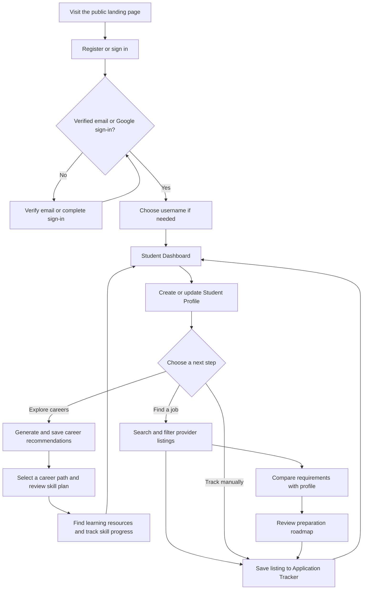
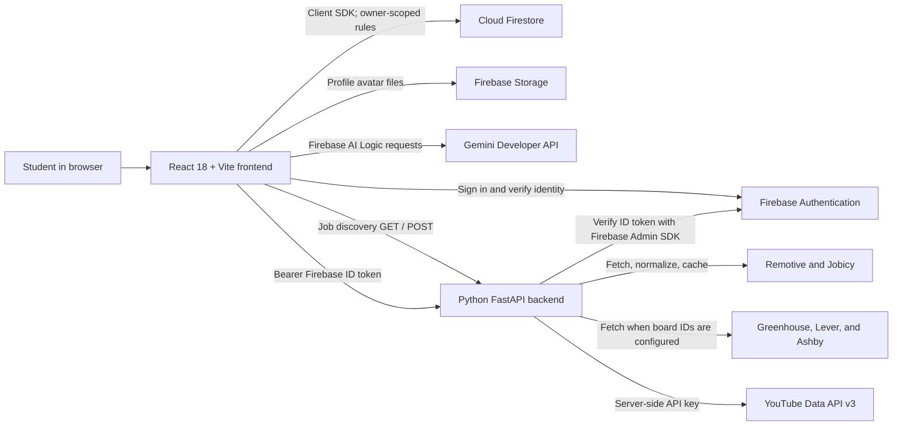
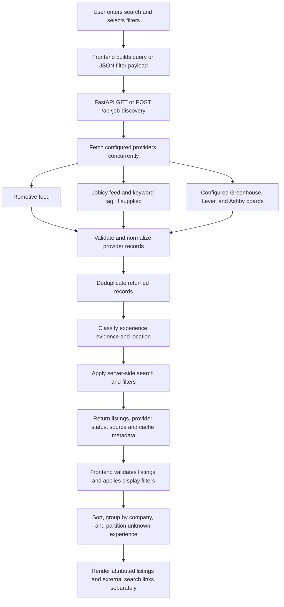

# CareerScout AI

**A practical, AI-assisted career discovery and job-search workspace for students and early-career candidates.**

[](https://github.com/bhanurgowda12/CareerScout-AI/stargazers)
[](https://react.dev/)
[](https://vite.dev/)
[](https://fastapi.tiangolo.com/)
[](https://www.python.org/)

CareerScout AI brings profile-based career recommendations, job discovery, skill preparation, and application tracking into one student-focused web application. It combines a React frontend, a Python FastAPI service, Firebase services, Gemini through Firebase AI Logic, and a small set of external job and learning-resource providers.

> **Project status:** The capabilities described below are implemented in the repository. Job and learning data depend on third-party providers and configuration; results are neither comprehensive nor guaranteed. Potential future work is separated in the [roadmap](#potential-future-roadmap).

**Repository:** [bhanurgowda12/CareerScout-AI](https://github.com/bhanurgowda12/CareerScout-AI)

## Table of Contents

- [About the Project](#about-the-project)
- [Key Features](#key-features)
  - [Authentication and User Access](#a-authentication-and-user-access)
  - [Student Dashboard](#b-student-dashboard)
  - [Student Profile](#c-student-profile)
  - [Career Path Recommendations](#career-path-recommendations)
  - [AI Job Match Analyzer](#d-ai-job-match-analyzer)
  - [Advanced Job Discovery](#e-advanced-job-discovery)
  - [Skill Gap Analysis and Preparation Roadmaps](#f-skill-gap-analysis-and-preparation-roadmaps)
  - [Job Application Tracker](#g-job-application-tracker)
  - [Learning Resources](#h-learning-resources)
  - [Resume Builder and Settings](#additional-tools)
- [How CareerScout AI Works](#how-careerscout-ai-works)
- [System Architecture](#system-architecture)
- [Job Discovery Data Flow](#job-discovery-data-flow)
- [Technology Stack](#technology-stack)
- [Project Directory Structure](#project-directory-structure)
- [Application Setup](#application-setup)
- [Environment Variables](#environment-variables)
- [Backend API Documentation](#backend-api-documentation)
- [Testing and Build](#testing-and-build)
- [Security and Data Handling](#security-and-data-handling)
- [Current Limitations](#current-limitations)
- [Potential Future Roadmap](#potential-future-roadmap)
- [Screenshots and Demo](#screenshots-and-demo)
- [Contributing](#contributing)
- [License and Acknowledgements](#license-and-acknowledgements)

## About the Project

Students and job seekers often have to piece together career ideas, skill requirements, job listings, learning material, and application follow-ups from separate tools. CareerScout AI gives them a single place to organize those steps and connect them to information in their own profile.

The application is intended for students, recent graduates, and early-career job seekers who want to:

- Explore role and career-path options related to their education, skills, projects, and interests.
- Review job opportunities returned by supported providers and understand where each listing came from.
- Compare job-posting requirements with evidence in a saved profile.
- Turn skill gaps into a suggested preparation sequence and find learning materials.
- Keep saved jobs and application progress organized.

CareerScout is a guidance and organization tool. Its recommendations, scores, classifications, and roadmaps are informational; they do not predict hiring decisions or replace checking the original posting.

## Key Features

### A. Authentication and User Access

- **Firebase Authentication** supports email/password registration and sign-in, email verification, and Google sign-in.
- Email/password accounts must verify their email before accessing student pages. Google sign-in is accepted as verified access by the application.
- After verification, a user chooses a CareerScout username. Protected pages include the dashboard, profile, career recommendations, learning, job discovery, job matching, tracker, resume builder, and settings.
- The frontend listens for Firebase authentication state changes and returns signed-out users to the sign-in flow when they open protected pages.

### B. Student Dashboard

The dashboard reads the signed-in user's profile, saved career recommendations, skill progress, and recent profile history from Firestore. It presents:

- Profile-completion and learning-progress indicators.
- Saved career-path and completed-skill counts.
- Recent profile and skill-completion activity.
- Shortcuts to profile editing, recommendations, learning, job discovery, job matching, resume building, and the application tracker.
- A selected career path's next skills and a preview of recent recommendations.

Dashboard figures reflect saved data that the current account can access; they are not employment-outcome metrics.

### C. Student Profile

The profile can store a name and editable contact/profile details, summary, education, graduation year, skills, interests, experience level, projects, certifications, preferred work areas and industries, career interests, and professional links such as LinkedIn, GitHub, portfolio, LeetCode, and HackerRank.

- Profile data is saved in the current user's Firestore profile document. Profile versions can be reviewed and restored.
- Profile photos can be uploaded to Firebase Storage. The checked-in rules allow verified owners to access JPEG avatar files up to 2 MB; the frontend accepts JPEG, PNG, or WebP input and processes it before upload.
- Profile evidence is used by career recommendations, the job-match analyzer, and job-discovery comparisons. The browser does not treat an omitted skill as proof that the user lacks it.

### Career Path Recommendations

Career recommendations use the saved profile to identify candidate roles from the project's career catalogue. The catalogue supplies role-specific pathways, estimated fit scores, existing evidence, missing-skill sequences, exercises, and project ideas.

- When Firebase AI Logic and App Check are available, Gemini contributes recommendation explanations, portfolio-project suggestions, and next-step text for selected catalogue roles.
- If Gemini is not configured or a non-authorization AI request fails, the app can return catalogue-based rule-generated recommendations instead. Authentication, permission, and App Check failures are surfaced rather than silently treated as a successful AI response.
- Generated recommendation sets are saved under the user's Firestore account and can be revisited in the dashboard and learning area.
- Scores are directional profile-to-catalogue estimates, not hiring probabilities or guarantees.

### D. AI Job Match Analyzer

The analyzer accepts a job description and compares its stated requirements with the user's saved profile. Users may also paste resume text as additional evidence.

1. Firebase AI Logic with Gemini extracts distinct skills and competencies stated in the job description; it is instructed not to invent requirements.
2. The browser compares those extracted requirements against profile skills, projects, certifications, and optional pasted resume text.
3. Results show matched requirements, requirements without matching evidence, and a percentage representing the share of identified requirements found in the supplied evidence.

The percentage is a keyword/evidence comparison, not an assessment of proficiency, competence, eligibility, or probability of being hired. “Unverified” means only that the supplied text did not establish a match. The job description is sent to the configured AI service for extraction; pasted resume text is compared locally in the browser and is not saved or sent to Gemini by this analyzer.

### E. Advanced Job Discovery

Job Discovery combines a role and company search experience with filters, source attribution, and profile-aware preparation tools.

**Search and filters**

- Search by keyword, role, company, location, and one or more skills; select one or more role categories.
- The role catalogue spans software development, AI and machine learning, data and analytics, mobile and game development, cloud and DevOps, cybersecurity, software testing, UI/UX and product design, embedded systems and IoT, electronics, robotics, blockchain, IT support, architecture and technical leadership, product/project management, and business operations.
- Filter by work mode, employment type, and opportunity/seniority view (including internships, fresher/graduate, entry-level, and experienced).
- Sort by provider order, newest, company, or job title; optionally group results by company.
- Use **Explore a Company** to search a company profile and any operator-configured company boards. A limited set of built-in company career links does not mean that a live job board is configured for those companies.

**Sources and coverage**

- Remotive and Jobicy provide remote-focused aggregator listings.
- Greenhouse, Lever, and Ashby board feeds are queried only when their board identifiers are supplied through the backend's `COMPANY_JOB_BOARDS_JSON` configuration. No company boards are configured by default.
- Listings are normalized, checked for expected fields and supported HTTPS source URLs, deduplicated, and labeled with their provider. A source outage can result in partial provider results and status warnings; the app reports provider availability separately from matched listing counts.
- Links to LinkedIn Jobs, Naukri, Indeed, and Google Jobs are external searches. CareerScout does not scrape those search pages or present them as integrated provider listings.

**Experience, location, and metadata handling**

- Opportunity type (for example, internship) and seniority (fresher/graduate, entry-level, or experienced) are treated as separate dimensions.
- A classification is labeled **source-reported** when provider metadata clearly supports it, **title-inferred** when a clear title signal supports it, or **description-inferred** when explicit eligibility wording supports it. Ambiguous or conflicting evidence stays **Unknown**.
- Employment labels such as “Full-time” do not by themselves establish seniority. Unknown listings remain accessible in a separately labeled, unconfirmed group when an experience filter is active and are excluded from confirmed-match counts.
- Work-mode and employment filters exclude known mismatches but keep records with missing or unrecognized values visible as unknown. Unknown information does not mean that a job is either suitable or unsuitable.
- When a location is entered, results distinguish source-confirmed local matches, remote worldwide listings, and remote listings with no stated location. Unverified locations are not presented as local matches.
- When several skills are selected, the search matches listings containing any selected skill in available title, description, category, or provider skill-tag data. Missing skills are not invented.

**Profile comparison and preparation**

- Listing cards show available source, location, work mode, employment, salary, publication date, and experience evidence; provider fields may be absent.
- Users can compare listing requirements identified from provider skill tags and a supported-technology vocabulary with saved profile evidence.
- A role-specific 2-, 4-, 8-, or 12-week preparation roadmap can suggest skill practice, portfolio, resume, and interview tasks. Its checkboxes are page state and are not saved as persistent progress.
- A listing can prefill a new “Saved” record in the Job Application Tracker.

### F. Skill Gap Analysis and Preparation Roadmaps

For career recommendations, the career catalogue compares the user's saved skills and other profile evidence with a role pathway. The interface presents relevant evidence, missing skills, ordered learning steps, priorities, and practical exercises or project milestones where available.

For a discovered job, the analyzer identifies posting requirements and profile evidence; the listing roadmap uses requirements not found in the profile as preparation targets. These comparisons are catalogue- and text-based, and should be checked against the original role requirements.

### G. Job Application Tracker

Applications are stored in the signed-in user's Firestore collection. A record can include company, role, posting URL, location, employment type, applied and follow-up dates, description, notes, and status.

- Supported statuses: **Saved**, **Applied**, **Interview**, **Offer**, **Rejected**, and **Withdrawn**.
- Add, edit, and delete records; search by company or title; filter by status; and sort by newest or follow-up date.
- Summary cards show tracked jobs, submitted applications, interviews, and offers. Follow-up dates can be identified as upcoming or overdue.
- Job Discovery can prefill tracker details from a listing; the new record starts as **Saved**.

### H. Learning Resources

The learning area uses a saved career recommendation's ordered skill plan, exercise suggestions, and linked items from the project's curated resource catalogue. Users can select a career path, choose learning-language preferences, open video resources, and mark skills complete. Completion is stored in the user's Firestore `skillProgress` collection and contributes to dashboard progress.

- YouTube results are requested through the backend's authenticated `/api/learning-resources` proxy, not directly from the browser with the API key.
- The video search supports English, Kannada, Hindi, Telugu, Tamil, Malayalam, Marathi, and Bengali relevance settings, and returns paginated results.
- A selected skill can also be opened directly from the job-match analyzer or job-discovery preparation roadmap without selecting a saved career path.
- YouTube's language relevance is approximate. Check each video's content and language; availability depends on the YouTube API key and quota.

### Additional Tools

- **Resume Builder:** creates an editable, in-browser resume draft with a live preview and print/save-as-PDF action. It can start from saved profile details, but edits to the resume draft are not written back to the profile or persisted as a separate document.
- **Settings:** supports username updates, theme preference, account details, sign-out, and password changes for email/password accounts.

## How CareerScout AI Works

The application supports a set of related paths rather than requiring every user to complete every step:



## System Architecture

The browser uses Firebase client SDKs directly for authentication, Firestore, Storage, and Firebase AI Logic. The FastAPI backend serves job discovery and proxies YouTube search; it does not read or write the user's Firestore profile.



Job discovery endpoints are public at the API layer; the frontend places Job Discovery behind its signed-in, verified-user UI. The YouTube learning-resource endpoint requires a Firebase ID token and a verified email or Google sign-in.

## Job Discovery Data Flow



### Providers, caching, and coverage

| Provider | Integration | Retrieval and cache behavior |
| --- | --- | --- |
| Remotive | Remote-job aggregator API | The backend normalizes up to 100 feed records and caches results in memory for 8 hours. |
| Jobicy | Public remote-jobs API | The backend requests up to two cursor pages of 200 listings per keyword/cache key, applies a tag only when a keyword was entered, and caches each keyword result for 1 hour. |
| Greenhouse | Official company board feeds | Searched only for board identifiers configured by the backend operator; in-memory cache is 15 minutes. |
| Lever | Official company board feeds | Searched only for configured board identifiers; in-memory cache is 15 minutes. |
| Ashby | Official company board feeds | Searched only for configured board identifiers; in-memory cache is 15 minutes. |

These are bounded feeds, not a census of job openings. Remotive and Jobicy are remote-focused; their feeds, metadata, pagination, and provider availability limit the roles returned. Company-board results require operator-verified identifiers and only cover configured boards. Cache entries are process-local and are lost when the backend restarts.

Source URLs in integrated listings link to the provider's listing. They are not equivalent to listings collected from LinkedIn, Naukri, Indeed, or Google Jobs: those services are exposed as external search links only. Listings can expire, change, be incomplete, or be unavailable at the original destination; verify role details with the provider or employer.

## Technology Stack

| Technology | Purpose in CareerScout AI |
| --- | --- |
| React 18 | Interactive single-page user interface and feature components. |
| Vite 6 | Frontend development server and production bundler. |
| JavaScript (ES modules) | Frontend UI, profile/job utilities, and browser-side comparisons. |
| Python 3.10+ | Backend runtime. |
| FastAPI and Uvicorn | HTTP API routes, request validation, CORS, and local API serving. |
| Firebase Authentication | Email/password and Google user sign-in. |
| Cloud Firestore | User profile, profile history, saved career recommendations, skill progress, and application records. |
| Firebase Storage | Profile avatar uploads. |
| Firebase App Check | Client attestation configuration used with Firebase AI Logic. |
| Firebase AI Logic and Gemini | Career-recommendation text and job-description requirement extraction. |
| Firebase Admin SDK | Backend verification of Firebase ID tokens for protected learning-resource requests. |
| Remotive and Jobicy APIs | Remote-focused job listing feeds. |
| Greenhouse, Lever, and Ashby boards | Optional company job feeds, when server-side board identifiers are configured. |
| YouTube Data API v3 | Skill-related video search through the authenticated backend proxy. |
| Node.js and npm | Frontend dependency installation, tests, and build scripts. |

## Project Directory Structure

```text
CareerScout-AI/
├── backend/
│   ├── main.py
│   ├── requirements.txt
│   ├── test_auth.py
│   └── test_job_discovery.py
├── frontend/
│   ├── .env.example
│   ├── index.html
│   ├── package.json
│   ├── package-lock.json
│   └── src/
│       ├── App.jsx
│       ├── AuthPanel.jsx
│       ├── CareerExplorer.jsx
│       ├── CareerRecommendations.jsx
│       ├── JobApplicationTracker.jsx
│       ├── JobDiscovery.jsx
│       ├── JobMatchAnalyzer.jsx
│       ├── ResumeBuilder.jsx
│       ├── SettingsPage.jsx
│       ├── SkillGapLearning.jsx
│       ├── StudentDashboard.jsx
│       ├── StudentProfile.jsx
│       ├── UsernameSetup.jsx
│       ├── ai.js
│       ├── careerCatalog.js
│       ├── firebase.js
│       ├── jobApplicationUtils.js
│       ├── jobDiscoveryUtils.js
│       ├── jobDiscoveryUtils.test.js
│       ├── jobMatchAi.js
│       ├── jobMatchUtils.js
│       ├── learningResourcesApi.js
│       ├── main.jsx
│       ├── resourceCatalog.js
│       ├── resumeEducation.js
│       ├── settingsUtils.js
│       ├── studentProfileUtils.js
│       ├── studentProfileUtils.test.js
│       └── style.css
├── shared/
│   └── experienceClassificationCases.json
├── .gitignore
├── firebase.json
├── firestore.rules
├── storage.rules
└── README.md
```

**Key files:** [App.jsx](frontend/src/App.jsx) routes between application views; [firebase.js](frontend/src/firebase.js) initializes the browser Firebase SDKs; [careerCatalog.js](frontend/src/careerCatalog.js) contains career roles, pathways, and rule-based matching; [jobDiscoveryUtils.js](frontend/src/jobDiscoveryUtils.js) filters and classifies job listings; [backend/main.py](backend/main.py) implements the API; and [firestore.rules](firestore.rules) / [storage.rules](storage.rules) define Firebase access policies.

Local environment files are ignored by Git and intentionally omitted from the tracked project tree; create them locally as described below. `.gitignore` excludes environment files and dependency/build directories.

## Application Setup

### Prerequisites

- Git
- Node.js 18 or newer and npm
- Python 3.10 or newer
- A Firebase project with a web app
- Google Cloud CLI (`gcloud`) for local Firebase Admin Application Default Credentials
- A YouTube Data API v3 key to use video search
- Firebase AI Logic and an App Check web provider to use Gemini-backed features

### 1. Clone the repository

```powershell
git clone https://github.com/bhanurgowda12/CareerScout-AI.git
Set-Location .\CareerScout-AI
```

### 2. Configure Firebase

1. Create or select a Firebase project and register a Web app.
2. Enable **Email/Password** and/or **Google** as Firebase Authentication providers.
3. Create a Cloud Firestore database and publish the repository's [firestore.rules](firestore.rules).
4. To use profile photos, enable Firebase Storage and publish [storage.rules](storage.rules). The repository's [firebase.json](firebase.json) points the Firebase CLI at these rules files; deploy them only after selecting your own Firebase project.
5. Configure Firebase AI Logic with the Gemini Developer API. Register a score-based reCAPTCHA Enterprise site key with Firebase App Check for the web app. Configure App Check enforcement in Firebase for the Firebase AI service used by your project.

### 3. Install and configure the frontend

In a PowerShell terminal from the repository root:

```powershell
Set-Location .\frontend
npm ci
Copy-Item .env.example .env.local
```

Edit `frontend/.env.local` and replace the example values with your own Firebase Web app configuration and App Check site key. These browser configuration values are not Firebase service-account credentials. Do not put a private key, YouTube API key, or other server secret in a `VITE_` variable.

For local development, keep `VITE_FIREBASE_APP_CHECK_DEBUG=false` unless you intentionally register and use an App Check debug token for your local app. Never ship debug mode or a debug token to production. See [Environment Variables](#environment-variables) for the full list.

Start the frontend in its own terminal:

```powershell
Set-Location .\frontend
npm run dev
```

Open the local URL printed by Vite, normally `http://localhost:5173`.

### 4. Install and configure the backend

In a second PowerShell terminal from the repository root:

```powershell
Set-Location .\backend
py -m venv .venv
.\.venv\Scripts\Activate.ps1
python -m pip install -r requirements.txt
```

Create a local `backend/.env` file (it is ignored by Git) or set these values in the backend process environment:

```dotenv
FIREBASE_PROJECT_ID=your-firebase-project-id
YOUTUBE_API_KEY=your-restricted-youtube-data-api-key
```

For local Firebase Admin authentication, sign in with Application Default Credentials:

```powershell
gcloud auth application-default login
```

Alternatively, configure `GOOGLE_APPLICATION_CREDENTIALS` to point to a service-account JSON file kept outside the repository. In production, prefer the hosting platform's workload identity when available.

Run the API from the `backend` directory:

```powershell
python -m uvicorn main:app --reload --host 127.0.0.1 --port 8000
```

The API health check is at `http://127.0.0.1:8000/api/health`. Job discovery can be used without third-party credentials for job providers to respond, but video search requires a valid YouTube API key; the authenticated learning endpoint also requires Firebase Admin credentials and the matching Firebase project ID.

### macOS or Linux

Use `cp .env.example .env.local` from `frontend`; create the virtual environment with `python3 -m venv .venv`, activate it with `source .venv/bin/activate`, then follow the same pip and Uvicorn commands.

## Environment Variables

| Variable | Required? | Purpose and configuration |
| --- | --- | --- |
| `VITE_FIREBASE_API_KEY` | Required for Firebase frontend | `apiKey` from your Firebase Web app configuration. |
| `VITE_FIREBASE_AUTH_DOMAIN` | Required for Firebase frontend | `authDomain` from your Firebase Web app configuration. |
| `VITE_FIREBASE_PROJECT_ID` | Required for Firebase frontend | `projectId` from your Firebase Web app configuration. It should match the backend Firebase project. |
| `VITE_FIREBASE_STORAGE_BUCKET` | Required for profile-photo uploads | `storageBucket` from your Firebase Web app configuration. |
| `VITE_FIREBASE_MESSAGING_SENDER_ID` | Required for Firebase frontend | `messagingSenderId` from your Firebase Web app configuration. |
| `VITE_FIREBASE_APP_ID` | Required for Firebase frontend | `appId` from your Firebase Web app configuration. |
| `VITE_FIREBASE_APP_CHECK_SITE_KEY` | Required for App Check-backed Gemini features | Public reCAPTCHA Enterprise site key registered for the Firebase web app. |
| `VITE_FIREBASE_APP_CHECK_DEBUG` | Optional; local development only | Set to `true` only in development when using a registered Firebase App Check debug token. Defaults to `false`; do not enable for production. |
| `VITE_API_BASE_URL` | Optional | Backend base URL. Defaults to `http://127.0.0.1:8000`. |
| `FIREBASE_PROJECT_ID` | Required for protected backend features | Firebase project ID used by Firebase Admin token verification. Set it to the same project as the frontend. |
| `YOUTUBE_API_KEY` | Optional for starting the API; required for video search | YouTube Data API v3 key. Keep it in the backend environment and restrict it to the YouTube Data API. |
| `GOOGLE_APPLICATION_CREDENTIALS` | Optional | Standard Google Auth path to a service-account JSON file if local Application Default Credentials are not otherwise available. Keep the file outside source control. |
| `COMPANY_JOB_BOARDS_JSON` | Optional | Server-side JSON object describing operator-verified company names and Greenhouse, Lever, or Ashby board identifiers. No boards are configured by default. |
| `CAREERSCOUT_ALLOWED_ORIGINS` | Optional | Comma-separated additional frontend origins allowed by backend CORS. The backend already allows its local Vite origins. Use exact trusted origins. |

Frontend values belong in `frontend/.env.local`; the checked-in [frontend/.env.example](frontend/.env.example) contains placeholders. The backend loads `backend/.env` with `python-dotenv` or can receive environment variables from its process/host. The repository does not provide a backend environment example file. Never commit actual credentials, private keys, or App Check debug tokens.

Example shape for optional company-board configuration (use only board identifiers verified by the operator):

```json
{
  "Example Company": {
    "officialName": "Example Company",
    "website": "https://example.com",
    "careersUrl": "https://example.com/careers",
    "boards": {
      "greenhouse": "operator-verified-board-id",
      "lever": "operator-verified-board-id",
      "ashby": "operator-verified-board-id"
    }
  }
}
```

## Backend API Documentation

The local API is served at `http://127.0.0.1:8000`. Interactive FastAPI documentation is available at `/docs` while the backend is running.

| Method | Endpoint | Authentication | Request | Response overview |
| --- | --- | --- | --- | --- |
| `GET` | `/` | None | No parameters. | Welcome message. |
| `GET` | `/api/health` | None | No parameters. | API status (`status` and `message`). |
| `GET` | `/api/job-discovery` | None at API layer | Query parameters: `query`, repeatable `category`, `roleTerms`, and `skills`; optional `company`, `location`, `workMode`, `employmentType`, `experience`, `mode` (`jobs` or `company`), `remoteOnly`, and `limit`. | `jobs`, `sources`, provider status/errors, cache and fetch metadata, listing counts, and optional company-profile details. |
| `POST` | `/api/job-discovery` | None at API layer | JSON filter object using the same fields (`category`, `roleTerms`, and `skills` are arrays). | Same response shape as the GET endpoint. The frontend uses POST for broad filter lists so they do not exceed URL limits. |
| `GET` | `/api/learning-resources` | Firebase Bearer ID token; verified email or Google sign-in | Required `skill` and supported two-letter `language`; optional `pageToken`. | `videos` containing `videoId`, `title`, `channelName`, `thumbnailUrl`, and `videoUrl`, plus `nextPageToken`. |

The job-discovery response's provider status makes partial results and source outages visible. Its returned job fields depend on provider metadata; fields such as experience, salary, work mode, or location may be empty or unknown. The learning endpoint returns up to 10 YouTube search results per page and reports configuration, authorization, provider, or quota errors instead of fabricating videos.

## Testing and Build

Run frontend tests and the production build from `frontend`:

```powershell
Set-Location .\frontend
npm run test
npm run build
```

Run backend unit tests from `backend` after installing its requirements:

```powershell
Set-Location .\backend
python -m unittest discover -v
```

The backend tests mock provider and Firebase/YouTube interactions; they do not demonstrate live third-party availability. Frontend tests use Node's built-in test runner and cover utility behavior such as profile validation, job filtering, and experience classification.

## Security and Data Handling

- Firebase Authentication identifies users. Protected frontend pages require a verified email or Google sign-in; the backend learning endpoint verifies a Firebase ID token with Firebase Admin and applies the same verified-email/Google-provider condition.
- Firestore access is governed by [firestore.rules](firestore.rules), which scopes profile, profile history, recommendations, skill progress, and application data to the verified owner. The tracker rules also validate supported fields, statuses, URLs, and date formats.
- Avatar operations use [storage.rules](storage.rules), which restrict access to the verified owner and accepts JPEG avatar files up to 2 MB. Firebase rules must be deployed to the same project used by the app.
- The backend reads Firebase project configuration and the YouTube API key from its process environment or backend `.env`. The YouTube key is used by the backend proxy and must not be put in frontend variables.
- `VITE_` values are included in the browser build; Firebase Web app configuration and the reCAPTCHA site key are public client configuration, not private server credentials. Do not put service-account keys, YouTube API keys, or debug tokens in frontend environment files.
- Career recommendation profile data is sent to Firebase AI Logic for generation, excluding the profile name and email from the model context. The Job Match Analyzer sends the job description for requirement extraction; pasted resume text is compared in the browser and is not saved or sent by that analyzer.
- The job-discovery routes do not require a Firebase token at the API layer. The frontend gates the screen, but deployments should treat those routes as public endpoints and configure hosting/network controls appropriate to their use.

These notes describe the checked-in application behavior and rules; they are not a substitute for reviewing Firebase project settings, App Check enforcement, provider terms, and production deployment configuration.

## Current Limitations

- **Coverage is bounded:** Remote-focused Remotive and Jobicy feeds do not represent every local, onsite, hybrid, internship, or fresher vacancy. Jobicy retrieval is capped at two 200-result pages per keyword/cache key; Remotive retrieval is capped at 100 records. Optional company boards only cover configured identifiers.
- **Metadata can be missing or ambiguous:** Experience, location, work mode, employment type, and salary depend on providers. Unknown is explicitly not interpreted as eligible/ineligible; filters retain some unknown metadata rather than excluding it.
- **Classification is heuristic:** Source labels are preferred, with conservative title/description inference. Conflicting or vague data can remain Unknown; classification is not employer verification.
- **Listings can change:** Providers may return expired or incomplete postings, and source availability can vary. Always confirm details and application status at the linked provider or employer.
- **AI is fallible:** Gemini output may vary or be unavailable. Career fit scores are estimates; job-match results are text/keyword evidence comparisons and do not assess skill depth or hiring outcomes.
- **Learning results are external:** YouTube results depend on API configuration, quota, availability, and approximate language relevance. Curated resource links and external video content should be checked for relevance and current pricing.
- **Some state is not persisted:** Resume Builder edits and per-job roadmap checkboxes are browser-session state, unlike saved profiles, recommendation records, skill progress, and tracker entries.

## Potential Future Roadmap

The following are **possible future improvements, not implemented commitments**. Existing filters or partial entry points are called out so they are not mistaken for completed expansion work.

- Improve fresher and internship discovery through more suitable, better-maintained provider feeds; current views classify/filter available results but do not create comprehensive dedicated feeds.
- Add more verified job providers and broaden local, onsite, and hybrid listing coverage.
- Expand the operator-configured company-board experience into a richer Company Explorer; the current app has company search and optional board lookup, not a comprehensive company directory.
- Improve experience-level classification as provider metadata and test coverage evolve.
- Expand skill equivalence and explainability in job matching beyond the current requirement extraction and text-evidence comparison.
- Broaden and maintain learning-resource recommendations across skills, languages, and resource types.
- Consider saving custom job-preparation roadmap progress and resume drafts to the user's account.

## Screenshots and Demo

No screenshots or demo video are currently included in the repository. Add real captures here when they are available; no screenshot paths are assumed.

| Screen | Screenshot |
| --- | --- |
| Landing page | *Screenshot not added yet.* |
| Student Dashboard | *Screenshot not added yet.* |
| Student Profile | *Screenshot not added yet.* |
| Job Discovery | *Screenshot not added yet.* |
| AI Job Match Analyzer | *Screenshot not added yet.* |
| Job Application Tracker | *Screenshot not added yet.* |
| Skill Gap Analysis | *Screenshot not added yet.* |

## Contributing

Contributions are welcome. There is no separate contribution guide in the repository yet; a standard GitHub workflow is:

1. Fork the repository and create a focused feature branch.
2. Make changes with tests or documentation updates appropriate to the change.
3. Run the frontend tests and build, and the backend unit tests when relevant.
4. Review `git diff` to ensure no local environment files, credentials, or generated output are included.
5. Open a pull request describing the change, how it was validated, and any relevant limitations.

Please avoid including real user data, API keys, service-account files, or App Check debug tokens in issues and pull requests.

## License and Acknowledgements

**No `LICENSE` file is present in this repository.** The project's license has not been specified; add a license before relying on reuse or redistribution permissions.

CareerScout AI uses Firebase, Gemini through Firebase AI Logic, Remotive, Jobicy, optional Greenhouse/Lever/Ashby company boards, and YouTube Data API v3. Their services and content remain subject to their respective terms, availability, and attribution requirements.
